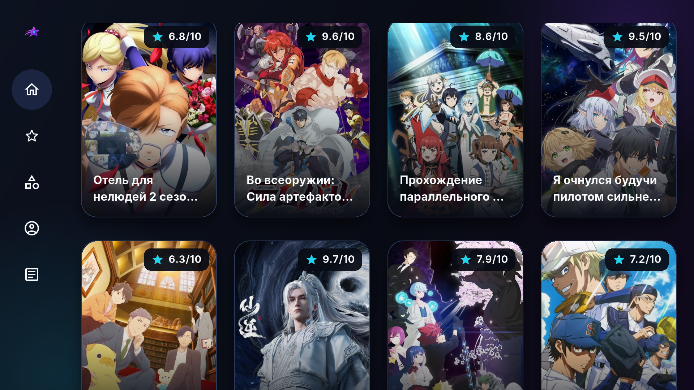

# 📺 AniStar TV

**AniStar TV — личный некоммерческий пет-проект:** неофициальный клиент AniStar на Flutter для Android TV и Android-телефонов.

Приложение позволяет найти аниме, выбрать серию и смотреть её на телевизоре или телефоне.



*Главная страница: каталог аниме с постерами и рейтингами.*

## ✨ Что умеет приложение

- Каталог, жанры, переходы по меткам и сортировка выдачи сайта.
- Избранное и отметки просмотренных серий, связанные с аккаунтом AniStar.
- Нативное HLS-воспроизведение, выбор серии и доступного качества, перемотка и пауза.
- Управление с пульта или касаниями экрана.
- Автоматический поиск доступного зеркала и переключение при отказе.

Для доступа к каталогу нужен аккаунт AniStar. Данные и видео загружаются напрямую с сайта.

## 🏭 AI Software Factory

Репозиторий также **демонстрирует мою AI Software Factory** — подход к разработке с AI-агентами на примере AniStar TV. Подробнее — в [руководстве по фабрике](docs/07_ai_tooling.md).

## 🚀 Быстрый старт

Нужны FVM, JDK 17, Android SDK и подключённое Android-устройство или эмулятор. Из корня проекта установите закреплённый SDK, подготовьте workspace, сгенерируйте маршруты и ресурсы, затем запустите dev-приложение:

```bash
fvm install
fvm flutter pub get --enforce-lockfile
fvm dart run melos bootstrap --enforce-lockfile
fvm dart run melos run generate
fvm dart run melos run run:dev
```

После запуска приложение проверит зеркало и сохранённую сессию. Если подтверждённой сессии нет, потребуется вход. Настройка окружения, выбор устройства и другие варианты запуска описаны в [Melos tooling](docs/melos_tooling.md).

## 📚 Документация

- [Документация](docs/README.md) — карта руководств, контрактов, пакетов и инструментов.
- [История изменений](CHANGELOG.md) — изменения по выпускам.

## 📄 Лицензия

Код приложения и материалы моей AI Software Factory — скиллы, описания ролей, контракты и скрипты — распространяются по лицензии [MIT](LICENSE). Автор: [Alexey Zdorovich (Overman775)](https://github.com/Overman775).

При копировании или распространении копий либо существенных частей этих материалов сохраняйте уведомление об авторских правах и текст лицензии MIT.

Сторонние компоненты и материалы могут распространяться на собственных условиях. Их лицензии остаются в силе.
