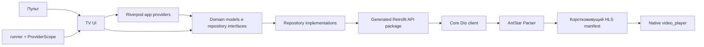

# 🏛️ Архитектура и структура | AniStar TV

Этот документ объясняет, как устроено приложение и где проходит граница между TV-клиентом и AniStar Parser. Он фиксирует текущую архитектуру без лишних слоёв «на будущее».

## 1. Основные принципы

1. **TV-first.** Любой экран проектируется для пульта, расстояния до телевизора и landscape-разрешения.
2. **Feature-first.** Код сгруппирован по пользовательским возможностям: каталог, аниме, воспроизведение.
3. **KISS и YAGNI.** Новая абстракция появляется только под реальную задачу.
4. **Типизированная граница.** Приложение получает данные только через OpenAPI-клиент AniStar Parser.
5. **Тестируемость.** Репозитории и управление состоянием не зависят от конкретного экрана.

---

## 2. Системная схема



AniStar TV не парсит HTML, не извлекает ссылки из WebView и не обращается к upstream CDN напрямую.

## 3. Слои feature

Каждая основная feature использует только те слои, которые ей действительно нужны.

| Слой | Ответственность | Может зависеть от |
| --- | --- | --- |
| `domain` | Модели и интерфейсы репозиториев | Pure Dart |
| `data/mappers` | DTO → domain mapping без UI и transport-ошибок | `domain`, generated client |
| `data/repositories` | OpenAPI-вызовы и реализация интерфейсов | `data/mappers`, `domain`, `core` |
| `presentation` | Экраны, TV-focus, BLoC и виджеты | `domain`, Flutter, UIKit |

> **Граница:** presentation не импортирует DTO сгенерированного клиента. Data-слой не управляет навигацией или виджетами.

### Core и UI kit

- `core/core.dart` — публичная граница для `Either`, `Failure`,
  `BaseRepository`, Dio/HTTP и storage. Features не импортируют его внутренние
  файлы по отдельности.
- `ui_kit` содержит только общие TV-токены и примитивы: Inter typography,
  focus target, backdrop, `AppNetworkImage`, skeleton, loading/error state и
  заголовок секции. Карточки, grid layouts и player controls остаются внутри
  feature, пока не появится второй независимый потребитель.

### Result-поток

Интерфейс репозитория возвращает `Either<Failure, T>`: `Left` содержит предсказуемую ошибку, `Right` — domain-данные. `BaseRepository` единожды переводит Dio-ошибки в `Failure`; mapper вызывается только для успешного DTO. Поэтому BLoC и экраны не зависят от `DioException`, HTTP-кода или generated DTO.

## 4. Структура проекта

```text
.
├── android/                       # Android TV manifest, flavors и Gradle
├── env/                           # Dev Dart define и production-шаблон
├── lib/
│   ├── app/                       # App, Riverpod composition root и typed GoRouter routes
│   ├── runner/                    # Инициализация сервисов и запуск Flutter
│   ├── packages/
│   │   ├── core/                  # Публичный core, API config, transport, ошибки и storage
│   │   ├── features/
│   │   │   ├── common/            # Общие состояния feature UI
│   │   │   ├── catalog/           # Каталог и пагинация
│   │   │   ├── anime/             # Детали аниме и серии
│   │   │   ├── home/              # Входной экран каталога
│   │   │   ├── player/            # Playback-сессия и HLS player
│   │   │   └── log_viewer/        # Просмотр локальных логов в dev
│   │   └── ui_kit/                # Токены темы и переиспользуемые TV-примитивы
│   ├── main_dev.dart
│   └── main_prod.dart
├── api/                           # Swagger Parser: Retrofit-клиенты и Freezed DTO
├── openapi/                       # Зафиксированная OpenAPI-схема
├── test/                          # Тесты с зеркальной feature-структурой
└── tool/generate_api.sh           # Воспроизводимая генерация API
```

## 5. Сборка приложения и DI

`runner.dart` инициализирует Flutter, storage и logger до `runApp()`. Затем он создаёт единственный `ProviderScope` Riverpod и передаёт в него runtime-зависимости через overrides. `app_providers.dart` — composition root: он собирает остальные зависимости:

- один настроенный `Dio`, `AnimeClient` и `VideoClient`;
- repository interface → конкретная реализация;
- logger и локальные storage-сервисы.

Репозитории получают зависимости через конструктор. Они не ищут их через `BuildContext`, поэтому остаются простыми для тестирования.

Riverpod — единственный DI-контейнер приложения. `provider` не используется в коде приложения; BLoC остаётся механизмом управления состоянием feature, а не вторым способом собирать зависимости.

Тест заменяет repository или logger через `ProviderScope.overrides`, не создавая реальный Dio или Parser-клиент.

### Логирование

Локальный package `app_logger` — единственная точка настройки `Logger`. В debug/profile он пишет подробные записи в консоль и локальные файлы; в release пропускает только ошибки и не создаёт файловые логи. Тот же logger получает запросы Dio (без query-параметров и секретных headers), события/ошибки BLoC, ошибки Flutter и переходы GoRouter. Экран логов и кнопка входа в него доступны только вне release.

## 6. Состояние и навигация

- `flutter_bloc` используется для каталога и пагинации, где есть последовательность событий и состояний.
- `flutter_riverpod` используется только для DI; presentation читает repository/logger providers, а domain/data остаются от Riverpod независимыми.
- Локальная асинхронная загрузка экрана аниме остаётся `Future`, пока более сложное состояние не требуется.
- Typed routes объявлены в `lib/app/`. Экраны сообщают о выборе через callbacks, а app-слой решает, куда перейти.
- Player всегда создаёт и освобождает собственный `VideoPlayerController` в рамках экрана.

Такой подход не заставляет все features использовать один шаблон, но сохраняет понятные границы.

## 7. Основной пользовательский поток

1. Каталог загружает первую страницу и показывает адаптивную TV-сетку.
2. `OK` на карточке открывает детали аниме и список серий.
3. Первый фокус находится на действии просмотра; `↓` переводит к сетке серий.
4. Перед открытием player создаётся новая playback-сессия.
5. Player получает HLS manifest и запускает нативное воспроизведение.
6. При ошибке поток не переиспользуется: пользователь создаёт новую сессию.

## 8. Архитектурные решения

Решения использовать Parser/OpenAPI, transport и границы общих пакетов
описаны в [ADR](adr/README.md).
