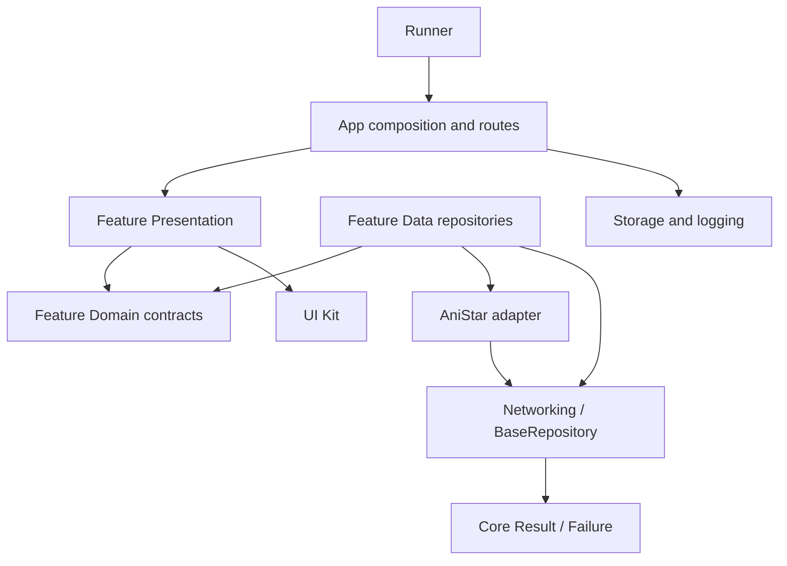

# 🏛️ Архитектурные принципы | AniStar TV

AniStar TV получает каталог из HTML сайта, преобразует его в модели приложения и воспроизводит HLS напрямую на Android. Этот документ объясняет границы этих частей и выбор места для нового кода. Подробности реализации перечислены в [структуре проекта](02_project_structure.md), [сетевом руководстве](04_network_and_playback.md) и [ADR](adr/README.md).

## 1. Принципы

1. **Зависимость от контрактов.** Presentation обращается к domain repository interfaces. App связывает их с реализациями.
2. **Простота по текущей потребности.** Новая абстракция или пакет появляется для решаемой задачи, а не «на будущее».
3. **Один владелец ответственности.** Нейтральные `Result` и `Failure` принадлежат Core, Networking отвечает за транспорт, AniStar за протокол сайта, UI Kit за общие визуальные токены и виджеты.
4. **Проверяемость.** Внешние ресурсы передаются через конструктор или provider override. Native playback и HTTP можно подменить в тестах.

---

## 2. Слои и зависимости

| Слой | Владеет | Не должен владеть |
| :--- | :--- | :--- |
| **Core** | Pure Dart `Result`, `Failure`, `UnknownFailure` | Flutter, transport, AniStar и app/features |
| **Infrastructure** | HTTP, storage, logging и адаптер сайта | Маршрутами и UI приложения |
| **Feature Domain** | Domain-моделями и repository interfaces | Dio, HTML/JSON5, Flutter widgets и Riverpod |
| **Feature Data** | Реализацией repository и преобразованием DTO в domain | App routing и чужими private `src/` |
| **Feature Presentation** | Экраном, UI-состоянием и локальным lifecycle | Конкретной transport-реализацией |
| **UI Kit** | Токенами, темой и общими компонентами | Сетевыми запросами и фичами |
| **App / Runner** | Запуском, композиционной сборкой и маршрутами | Деталями парсинга сайта |



**Правило зависимости:** Core не зависит от workspace-пакетов. Infrastructure не импортирует `lib/app` или features. Presentation использует domain-контракты и публичные библиотеки пакетов. App знает об implementation, потому что это composition root. Внешний импорт из `lib/src/**` закрыт. Архитектурные тесты проверяют границы.

> **Почему:** изменение transport или HTML-разметки не должно менять экраны и domain-модели. Публичный API обозначает разрешённую зависимость. Детали реализации остаются у своего владельца.

---

## 3. Feature и repository

Feature группирует код по пользовательской области, а не по общему типу файла. Domain задаёт контракт. Data адаптирует сайт или infrastructure к этому контракту. Presentation отображает результат.

Например, каталог зависит от `CatalogRepository`, а `AnistarCatalogRepository` реализует его через `AnistarClient`. DTO сайта не проходят через UI.

```dart
catalogRepositoryProvider.overrideWith(
  (ref) => AnistarCatalogRepository(
    ref.watch(anistarClientProvider),
    ref.watch(loggerProvider),
  ),
);
```

Так устроена привязка каталога в `createAppOverrides`: feature объявляет `CatalogRepository`, а app собирает реализацию через общий `AnistarClient` и `Logger`. Реализация переводит DTO сайта в domain-модели и возвращает `Result` через `BaseRepository`.

Domain-модели и state immutable: изменение создаёт новое значение, а коллекции не должны случайно мутироваться после публикации. Generated sources не правятся вручную.

---

## 4. DI и состояние

`flutter_riverpod` служит DI-контейнером и механизмом композиции. `flutter_bloc` управляет состоянием экранов, где нужны события и последовательные переходы. Riverpod providers/notifiers обслуживают сервисное и асинхронное состояние, которое уже так организовано в проекте. Не переносите бизнес-логику в provider и не вводите второй DI-механизм. Решение зафиксировано в [ADR-0004](adr/0004-use-riverpod-for-app-di.md) и уточнено в [ADR-0007](adr/0007-neutral-core-and-infrastructure.md).

Контракт репозитория объявляет provider у feature. `lib/app/app_container.dart` подставляет реализацию через overrides. Сами BLoC, repository и сервисы получают зависимости конструкторами. `BuildContext`, роутер и Riverpod не проникают в domain/data-классы.

```dart
final catalogRepositoryProvider = Provider<CatalogRepository>(
  (ref) => throw StateError('CatalogRepository must be supplied by the application.'),
);
```

Заглушка указывает на обязательный binding. Не добавляйте feature-wide `ProviderScope`: проект использует один корневой scope, а жизненным циклом отдельных объектов управляют их provider или владеющий `State`.

---

## 5. Результаты, ошибки и навигация

`HtmlAnistarClient` выдаёт безопасный `AnistarClientException` для ожидаемого отказа сайта. Feature Data преобразует его через `mapAnistarErrors` в соответствующую `Failure`. `BaseRepository` один раз оборачивает её в `Result<T, Failure>` на границе Data/Presentation. Не передавайте HTML, cookies или детали сессии в feature state. Не превращайте сетевые исключения в успешные пустые данные.

| Ошибка | Владелец |
| :--- | :--- |
| Dio timeout/connection/status | Networking (`NetworkFailure` и другие transport failures) |
| Ожидаемая ошибка сайта | `AnistarClientException` → feature data mapper → `Failure` |
| Неожиданное исключение на repository boundary | `UnknownFailure` в Core |
| Ошибка native playback | Player domain (`PlaybackFailure`) |

Нормализованные DTO сохраняют source ID/slug, nullable semantics и полный manifest URI с headers/expiry. Не раскладывайте общий site contract по feature и не меняйте семантику полей без обновления [ADR-0010](adr/0010-normalized-anistar-contract.md).

`GoRouter` и typed routes принадлежат `lib/app`. Feature сообщает о выборе через callback либо вызывает собственную локальную навигацию. App решает, какой маршрут открыть. BLoC не выполняет переходы и не получает `BuildContext`. Локальный dialog закрывает UI.

---

## 6. Lifecycle

| Ресурс | Владелец и завершение |
| :--- | :--- |
| Logger и storage при запуске | Runner создаёт и передаёт через overrides |
| Корневой `ProviderScope` и repository overrides | App composition |
| Общий Dio | Networking provider закрывает через `ref.onDispose` |
| AniStar client и cookie session | Infrastructure providers. Они привязаны к origin и не закрывают общий Dio повторно |
| Catalog BLoC | Создавший его экран/провайдер закрывает при dispose |
| Log viewer BLoC | `BlocProvider` закрывает созданный экземпляр |
| Video controller, listener, focus и timer | `State` плеера освобождает при замене источника или dispose |

При смене зеркала пересоздаются Dio, AniStar client и origin-bound session. Плеер освобождает прежний controller прежде, чем установить новый. Политика авторизации и воспроизведения описана в [сетевом руководстве](04_network_and_playback.md).

---

## 7. Навигация и платформенные профили

Основной профиль приложения рассчитан на телевизор, Android phone имеет отдельную touch-компоновку. Общие domain-данные и playback сохраняются, но взаимодействия описаны раздельно: [ADR-0008](adr/0008-youtube-tv-interaction-reference.md), [TV-контракт](specs/06_tv_interaction.md), [mobile-контракт](specs/10_mobile_interaction.md). Изменение ориентации само по себе не переключает телефон в TV-профиль.

Для изменения интерфейса сначала сверяйте соответствующую спецификацию и UI Kit. Новый системный контракт фиксируйте в ADR. Подробный сценарий описывайте в подходящей спецификации, а не копируйте во все руководства.
