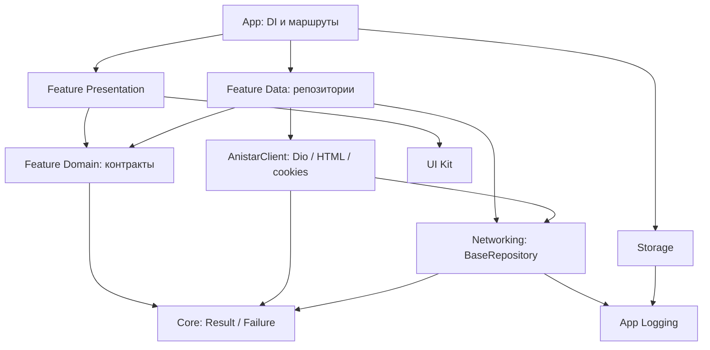

# 🏛️ Архитектурные принципы | AniStar TV

Приложение получает HTML AniStar и воспроизводит HLS с CDN напрямую на Android.

## 1. Основные принципы

1. **Dependency Inversion**: features работают с repository interfaces; app выбирает реализации.
2. **KISS / YAGNI**: добавляем пакеты и абстракции под текущую задачу.
3. **DRY**: нейтральные типы принадлежат Core, сервисы своим infrastructure-пакетам, общие виджеты UI Kit.
4. **Тестируемость**: зависимости передаются конструкторами; HTTP и native player заменяются в тестах.

---

## 2. Feature-First & Clean Architecture

| Слой | Ответственность |
| --- | --- |
| **Core** | Pure Dart: Result, Failure, UnknownFailure |
| **Infrastructure** | Сеть, хранилища, логирование, адаптер AniStar |
| **UI Kit** | Тема, TV-токены и общие виджеты |
| **App** | Запуск, связывание реализаций и маршруты |
| **Features** | Каталог, карточка, просмотр и диагностический экран |

Внутри feature:

- **Domain**: модели и repository interfaces; зависит только от Core.
- **Data**: repository implementations; использует публичные API инфраструктуры.
- **Presentation**: экраны, виджеты и BLoC; работает с domain-контрактами.

> **Правило зависимости:** Core не имеет package-зависимостей. Infrastructure не импортирует app/features. Сетевые features используют domain-контракты вместо Data и не импортируют app DI. Чужой `src/**` не используется.

Локальный dev viewer создаёт FileLogRepository внутри LogViewerScreen; его файловый доступ отделён от сетевых репозиториев.



---

## 3. Dependency Injection и состояние

**Riverpod** связывает зависимости. Один `anistarClientProvider` в корневом `ProviderScope` служит общей точкой доступа к данным сайта для всех сетевых репозиториев. `DioAnistarClient` координирует HTTP, парсинг и общую cookie-сессию; репозитории зависят от контракта `AnistarClient`. Репозитории, сервисы и BLoC получают их через конструктор.

```dart
catalogRepositoryProvider.overrideWith(
  (ref) => AnistarCatalogRepository(
    ref.watch(anistarClientProvider),
    ref.watch(loggerProvider),
  ),
);
```

Провайдеры сервисов находятся у владельцев. Feature-провайдеры объявляют repository interfaces; `lib/app/app_container.dart` подставляет реализации через `createAppOverrides`. Default провайдеров-контрактов требует явного binding.

**BLoC** управляет состоянием каталога и логов. Карточка и плеер управляют локальным async lifecycle в State. BLoC не получает BuildContext и не выполняет навигацию.

Клиент получает Dio и сессию через конструктор, не читает Ref и не использует статический singleton. При смене origin контейнер пересоздаёт клиент и его зависимости; cookies остаются привязаны к зеркалу. Правила транспорта и исключения: [ADR-0009](adr/0009-single-anistar-client-and-dio.md).

### Владение lifecycle

| Объект | Владелец |
| --- | --- |
| Инициализация logger и preferences | Runner |
| Корневой ProviderScope и overrides | App composition |
| Общий Dio | Networking, закрытие через `ref.onDispose` |
| AnistarClient и cookie-сессия | Riverpod infrastructure providers; клиент не закрывает общий Dio повторно |
| CatalogBloc | State каталога, явный close при dispose |
| LogViewerBloc | BlocProvider, автоматический close |
| Native video controller, focus и timer | State плеера, освобождение при замене/уходе |

---

## 4. Result на границе репозитория

Репозитории каталога, карточки и воспроизведения возвращают `Future<Result<T, Failure>>`. Парсер и transport возвращают данные или бросают исключения. BaseRepository переводит их в Result один раз; UI превращает результат в состояние экрана.

- **NetworkFailure** принадлежит networking.
- **AnistarFailure** принадлежит адаптеру сайта.
- **PlaybackFailure** принадлежит domain плеера.
- **UnknownFailure** хранится в Core.

---

## 5. Навигация

GoRouter и typed routes находятся в app. Экраны получают callbacks: `onAnimeTap`, `onEpisodeTap`, `onOpenLogs`. App определяет маршрут и доступность debug-действий.

HomeScreen компонует CatalogScreen. Остальные features не получают прямые ссылки на экраны друг друга. Локальные диалоги плеера закрываются через Navigator.

Структура файлов: [Структура проекта](02_project_structure.md). Решения: [ADR](adr/README.md).
