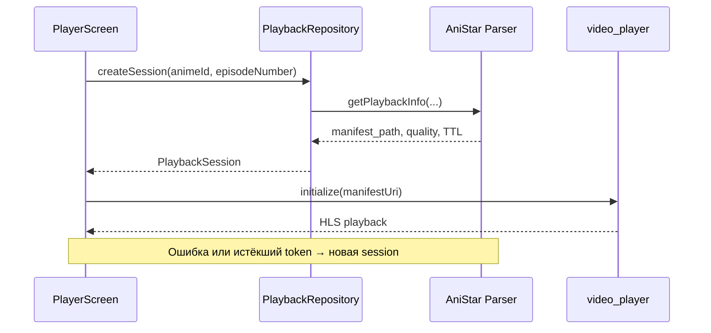

# 🌐 Сеть, OpenAPI и HLS | AniStar TV

Этот документ описывает границу с AniStar Parser: конфигурацию клиента, mapping DTO и жизненный цикл защищённого HLS-воспроизведения.

## 1. Сетевой стек

| Компонент | Назначение |
| --- | --- |
| `core/network/DioClient` | Единый Dio, timeout и безопасные retry |
| `core/network/HttpClient` | Лёгкий `package:http`-клиент для endpoint вне OpenAPI |
| `api/` | Swagger Parser: Retrofit endpoints и Freezed DTO |
| Feature repositories | DTO → domain mapping и нормализация ошибок |
| `video_player` | Нативное HLS-воспроизведение |

> **Правило границы:** generated client не используется напрямую из presentation. Экран работает с domain-моделями и repository interfaces.

`BaseRepository` возвращает `Either<Failure, T>` и централизованно маппит timeout, соединение, `404`, `429` и `5xx`. Каждый feature mapper преобразует только успешные DTO в domain-модели.

## 2. Конфигурация endpoint

Базовый URL передаётся при запуске:

```bash
--dart-define=ANISTAR_API_URL=https://parser.example.com/
```

| Среда | Endpoint |
| --- | --- |
| Android Emulator | `http://10.0.2.2:8001/` |
| Локальный desktop | `http://127.0.0.1:8001/` |
| Физический TV | LAN-адрес parser или HTTPS |
| Production | Только HTTPS |

Dev flavor разрешает cleartext для локальной разработки. Prod manifest его блокирует.

Клиент использует таймауты: connect — 8 секунд, send — 8 секунд, receive — 20 секунд. Повторяются только безопасные GET/HEAD/OPTIONS/PUT-запросы при временных transport/5xx ошибках; отмена и `401` не повторяются.

## 3. Используемый контракт

Каноническая схема находится в `openapi/anistar.openapi.json`. Её источник — `openapi.json` соседнего проекта `anistar_parser`.

| Операция | Назначение |
| --- | --- |
| `AnimeClient.getApiAnime` | Страница каталога |
| `AnimeClient.getApiAnimeSlug` | Название, описание и метаданные |
| `AnimeClient.getApiAnimeAnimeIdEpisodes` | Доступные серии |
| `VideoClient.getApiVideo…Playback` | Новая playback-сессия и HLS manifest |

Репозитории преобразуют transport DTO в модели `AnimeSummary`, `AnimeDetails`, `AnimeEpisode` и `PlaybackSession`. Некорректное изображение не должно ломать весь экран.

## 4. Жизненный цикл playback-сессии



### Практические правила

- Не сохраняйте `manifest_path` в storage.
- Не подменяйте manifest прямой CDN-ссылкой.
- Показывайте фактически выбранное parser качество: оно может быть ниже запрошенного.
- Retry создаёт новую playback-сессию и новый `VideoPlayerController`.
- Инициализация, завершившаяся после ухода с экрана, должна освободить controller.
- WebView для воспроизведения не используется.

## 5. Обработка ошибок

`BaseRepository` переводит Dio-ошибку в типизированный `Failure`. Если Parser
вернул непустой `detail`, это сообщение сохраняется для UI; техническая
причина и stack trace остаются доступны logger.

| Ситуация | Поведение UI |
| --- | --- |
| Нет соединения / timeout | Показать retry |
| `404` | Сообщить, что аниме или серия недоступны |
| `429` | Предложить повторить позже |
| `502` / `503` | Сообщить о временной недоступности parser |
| Ошибка HLS во время просмотра | Создать новую session |

Техническая ошибка записывается в logger. Подписанные URL и токены не должны попадать в документацию или пользовательские сообщения.

## 6. Обновление OpenAPI-клиента

1. Обновите схему в соседнем `anistar_parser`.
2. Проверьте parser-тесты и `openapi.json`.
3. Скопируйте схему в `openapi/anistar.openapi.json`.
4. Запустите генерацию:

```bash
bash tool/generate_api.sh
```

Скрипт запускает в `api/` `swagger_parser`, затем `build_runner`. Первый строит Retrofit-клиенты из OpenAPI, второй создаёт реализации Retrofit и Freezed/JSON DTO.

После генерации выполните:

```bash
fvm dart analyze api
fvm flutter test
```

Generated-файлы в `api/lib/src` не редактируются вручную. Правила именования и сериализации фиксируются в `api/swagger_parser.yaml`.
