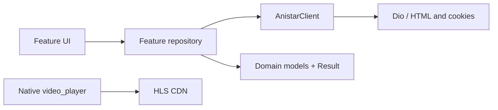

# 🌐 Работа с сетью и HLS | AniStar TV

Dio получает HTML AniStar. DOM и JSON5 разбираются на устройстве. Native `video_player` воспроизводит HLS с CDN через Android Media3. Так транспорт сайта отделён от транспорта видео. Приложение не исполняет скрипты сайта и не проксирует медиапоток. Подробные контракты и приёмка приведены в [спецификациях](specs/README.md).

## 1. Границы сетевого слоя

| Компонент | Владелец | Ответственность |
| --- | --- | --- |
| DioClient | networking | Единая фабрика HTTP transport, таймауты, retry и сетевые логи |
| BaseRepository | networking | Исключения → Result / Failure |
| AnistarClient / HtmlAnistarClient | anistar | Общий клиент: HTML, авторизация, cookie-сессия и DTO |
| HtmlDecoder / AnistarHtmlParser | anistar | Charset, DOM, playlst и DTO |
| Feature repository | Feature Data | DTO → domain |
| VideoPlayerController | Player UI | Native HLS и lifecycle |

> **Правило:** Transport не содержит правил AniStar. Source и парсер не возвращают Result. Репозиторий выполняет маппинг на своей границе.

> **Почему:** общие ошибки transport и правила протокола сайта принадлежат разным слоям. Это позволяет менять сайт, не связывая networking с его HTML и авторизацией.

---



Клиент передаётся всем сетевым репозиториям через `anistarClientProvider` в Riverpod. Репозитории возвращают domain-модели и `Result`. Плеер получает manifest URI и headers из playback repository. Он использует native transport. DI, границы и lifecycle описаны в [ADR-0009](adr/0009-single-anistar-client-and-dio.md).

---

## 2. HTML и JSON5

Зеркало задаётся HTTPS origin через `ANISTAR_MIRROR_URL`, default: `https://v30.astar.bz/`. Dev и prod используют одинаковый default. Настройка через файл: `env/dev.json` или собственный `env/prod.json` по шаблону `env/prod.example.json`.

| Данные | GET |
| --- | --- |
| Каталог | `/anime/`, `/anime/page/{page}/` |
| Карточка | `/{slug}.html` |
| Серии и свежие ссылки | `/test/player2/videoas_p2p_new.php?id={anime_id}` |

Source передаёт `Accept: text/html`, `User-Agent: AniStarTV/1.0` и `Cache-Control: no-cache`. Ответ читается как bytes. HtmlDecoder выбирает Windows-1251 или UTF-8 по Content-Type.

Парсер поддерживает desktop `.news` и mobile `.plash`, исключает рекламный ID **9493** и дубликаты, читает следующую страницу из pagination links. Карточка использует `h1[itemprop=name]`, `ul.head`, `.descripts` и poster.

PlaylistLiteral выделяет сбалансированный массив **playlst** с учётом кавычек, escape и комментариев. JSON5 разбирается как данные. Номер серии, качество и URL читаются из одного объекта. HLS берётся из **files**. Скрипты страницы не исполняются.

---

## 3. Репозитории и ошибки

### Граница обработки

Feature repository наследует BaseRepository и выполняет запрос через makeApiCall:

```dart
final result = await repository.getPage(1);
result.when(
  success: (page) => showPage(page),
  failure: (failure) => showError(failure.message),
);
```

Пример показывает обработку результата. showPage / showError обозначают переходы в состояние UI.

BaseRepository переводит DioException в сетевые Failure. Он сохраняет уже созданный Failure и оборачивает неожиданное исключение в UnknownFailure. Клиент AniStar распознаёт 403/challenge. Парсер распознаёт защитную страницу и повреждённую разметку. UI получает понятную ошибку и действие повторного запроса.

| Ограничение | Значение |
| --- | --- |
| HTTP connect / send timeout | 8 секунд |
| HTTP receive timeout | 20 секунд |
| Transport retry | До двух повторов идемпотентного запроса при сетевых ошибках, HTTP 408/429/5xx |
| HTTP 403 | Без transport retry |
| Инициализация native controller | До 35 секунд |

---

## 4. Playback session

Перед каждым открытием репозиторий получает свежий player HTML. Session содержит manifest URI, Referer, выбранное и запрошенное качество, доступные качества/серии и необязательное expiresAt из `end`.

**Подписанный URI сохраняется целиком**, включая `+`, запятые и структуру пути. Клиент не генерирует key. Если запрошенное качество отсутствует, выбирается наибольшее доступное для этой серии.

```dart
VideoPlayerController.networkUrl(
  session.manifestUri,
  formatHint: VideoFormat.hls,
  httpHeaders: session.httpHeaders,
);
```

> **Формат нельзя определять по расширению.** Новый 720p URL заканчивается на `.mp4`, но содержит HLS. Передавайте VideoFormat.hls явно.

Referer указывает на player page с anime_id. Android HTTP data-source factory передаёт его манифестам и сегментам. Native HLS разрешает относительные и абсолютные ссылки. Браузер и HTTP-прокси не участвуют. `files_mp4`, скачивание и офлайн-просмотр не используются.

---

## 5. Восстановление и lifecycle

- На выбранный пользователем источник разрешён **один автоматический refresh**: свежий HTML, новый controller, восстановление позиции и паузы.
- Бюджет общий для ошибки инициализации и ошибки во время просмотра. Успешный retry не запускает бесконечную цепочку повторов.
- Ручной retry и явная смена серии/качества начинают новый бюджет. Смена качества сохраняет позицию. Новая серия начинает просмотр с нуля.
- Изменение anime_id или номера серии в маршруте открывает новый источник с нуля. Ошибка нативной команды использует тот же бюджет восстановления.
- Старый controller освобождается до создания следующего. Идентификатор операции отбрасывает поздний результат запроса.
- При уходе освобождаются controller, listener, focus node и timer.

Логи содержат статус, host и серию/качество. HTML и native errorDescription с подписанными ссылками не сохраняются в сообщениях и не показываются пользователю.

Transport пишет origin и только явно разрешённые публичные paths из NetworkConfig: подписи могут находиться и в path, и в query. Query и остальные paths скрыты.
Сообщения стороннего retry interceptor отключены. После ошибки пагинации каталог
ждёт ручного повтора. События от прокрутки и фокуса не запускают новый запрос.

Если зеркало требует интерактивную проверку, приложение показывает отказ. Доступность с одного IP не гарантирует доступность с другого. Повторение live smoke и границы выводов: [Разработка и тестирование](05_development_and_testing.md#9-проверка-с-живым-аккаунтом).

---

## 6. Вход и сессия

App показывает LoginScreen до подтверждения сессии. AuthRepository находится в feature Auth. App назначает AnistarAuthRepository. Протокол DLE, cookie policy и HTML-маркеры принадлежат пакету anistar. Нейтральный networking не зависит от авторизации.

1. AnistarClient получает `/anime/`, находит POST-форму и сохраняет hidden-поля.
2. Передаёт `login_name`, `login_password` и `login=submit` с charset страницы. Windows-1251 применяется и к кириллице в логине/пароле.
3. Успех подтверждается ссылкой `action=logout` на текущем origin и выданными cookies. HTTP 200 с формой входа считается отказом.
4. Cookies и имя аккаунта сохраняются одной записью в SecureStorage. Пароль не сохраняется.
5. При следующем запуске клиент проверяет сохранённые cookies через HTML сайта. Сетевая ошибка оставляет запись для ручной повторной проверки, но не открывает каталог.

AnistarSession использует cookie_jar для domain/path policy. Он также проверяет expiry Secure cookies. Ключ `anistar.session.v1.<encoded HTTPS origin>` отделяет зеркала и порты. Cookies передаются только текущему origin. Переход формы на другое зеркало отклоняется.

Авторизация допускает до трёх redirect-переходов через GET. Пароль не отправляется повторно. POST не имеет автоматического retry.

Выход удаляет только запись текущего зеркала и cookies в памяти. Это локальный выход: запрос выхода на сайт не отправляется. Generation отбрасывает cookies из запоздавших ответов. Если защищённую запись удалить не удалось, UI сообщает ошибку и не объявляет выход успешным.

Гостевая форма вместо авторизованной HTML-страницы завершает сессию и удаляет protected router вместе с плеером. HTTP 403 сам по себе не завершает сессию: он может означать блокировку зеркала. Player HTML без формы/ссылки выхода не используется для определения статуса аккаунта.

SecureStorage использует Android backend flutter_secure_storage. Ошибки чтения/записи не скрываются. Каталог открывается только после успешного сохранения. Android backup отключён, чтобы cookies не восстанавливались отдельно от ключа шифрования.

Пароль, cookies, HTML и печатные клавиши не попадают в логи. Cookies AniStar не передаются native HLS. CDN использует подписанный URL и Referer.


---

## 7. Избранное сайта

FavoritesRepository использует общий авторизованный AnistarClient. Список читается через `/index.php?do=favorites&cstart={page}`. Пагинация поддерживает query и `/favorites/page/{page}/`. Рекламный ID 9493 исключается. Явное сообщение сайта в `#dle-content` подтверждает пустой список.

Пустой контейнер без дочерних элементов тоже может подтвердить пустой список. В этом случае одновременно должны выполняться все условия:

1. Подтверждена авторизация.
2. Заголовок: «Мои закладки».
3. Canonical URL избранного имеет тот же origin.

Неизвестная разметка считается ошибкой.

Статус читается из `doFavorites(id, 'plus'|'minus')` в HTML. Значение plus означает «добавить», а minus означает «удалить». Проверяется ID текущего сериала. Отсутствующий или противоречивый control означает неизвестный статус. В этом случае предлагается перечитать страницу. Скрипты не исполняются.

1. Перед изменением клиент получает свежую карточку и проверяет статус.
2. Если желаемый статус уже установлен, запрос изменения не выполняется.
3. Иначе GET `/engine/ajax/favorites.php` передаёт `fav_id`, `action=plus|minus`, `skin` из inline-переменной `dle_skin` и `alert=0`. Referer указывает на карточку. Общий session interceptor передаёт cookies.
4. Ответ должен содержать control того же ID с новым действием. Затем клиент снова получает карточку и проверяет сохранённый статус.
5. Только после подтверждения обновляются значок, кнопка и вкладка избранного. HTTP 200 с `error` не означает успех.

Mutating GET исключён из transport retry. После ошибки повтор инициирует пользователь. Свежий статус предотвращает повторное переключение при потерянном ответе. FavoritesController допускает одно изменение одновременно.

Вкладки «Главная» и «Избранное» получают данные сайта. Карточка показывает звезду для подтверждённого избранного. Долгое касание или удержание OK открывает действие. Кнопка в карточке сериала выполняет то же изменение.

Удаление из карточки автоматически перечитывает открытый список избранного. Переход между вкладками и ручное обновление сбрасывают отображаемый кеш. Это позволяет учитывать изменения с другого устройства.

Постоянного локального списка нет. FavoritesState хранит только статусы текущего UI и уничтожается вместе с protected router при выходе. Контракт и точки входа в тесты: [Избранное](specs/02_favorites.md). Правила live-проверки: [Разработка и тестирование](05_development_and_testing.md#9-проверка-с-живым-аккаунтом).

---

<a id="автоматический-выбор-зеркала"></a>

## 8. Автоматический выбор зеркала

Для стандартных `https://vN.astar.bz/` клиент сохраняет только номер версии в Shared Preferences (`anistar.mirror.astar.bz.version`). При запуске используется сохранённая версия не ниже configured baseline. Некорректное значение игнорируется. Другие HTTPS origins, включая локальный E2E fixture, остаются фиксированными.

Перед восстановлением сессии или первым входом выполняется один GET каталога без cookies и credentials. HTTP 200 подтверждает доступность только при успешном разборе карточек. Challenge, пустая или посторонняя HTML и redirects не подтверждают зеркало. Проверка не повторяется на каждом запросе.

Если текущий сайт не отвечает, возвращает 403/451/5xx, перенаправляет на другой origin или показывает challenge, выполняется повторная проверка его каталога. При здоровом каталоге зеркало остаётся прежним. Отказ отдельного endpoint не означает блокировку сайта.

Если повторная проверка не подтверждает каталог, последовательно проверяются четыре следующие версии (`v30 → v31 → … → v34`). Каждый probe имеет connect/receive/send timeout 4 секунды и не следует redirect. TLS-проверка не отключается. Одновременные запросы используют одну операцию поиска.

Сохраняется только подтверждённая версия. После смены origin Riverpod пересоздаёт Dio, AnistarClient, repositories и origin-bound session. Protected router закрывается до подтверждения сессии нового зеркала.

Если для этого origin нет сохранённой сессии, потребуется новый вход. Cookies прежнего домена и пароль не переносятся. Исходный запрос не повторяется автоматически на новом домене. Это относится к POST входа и изменяющему GET избранного. Ошибки и истечение ссылок CDN обрабатываются отдельно механизмом player refresh.

Если диапазон недоступен, номер не изменяется. Отображается ошибка с предложением проверить интернет и повторить через минуту. До истечения минуты новые поиски не выполняются.

Отсутствие интернета тоже исчерпывает ограниченный поиск. Клиент не может отличить сетевую блокировку от недоступности зеркал. Понижение версии и поиск вне `astar.bz` не выполняются. Baseline можно изменить через `ANISTAR_MIRROR_URL`.

---

## 9. Отметки просмотра

Галочки читаются из серверного `viewing` в playlst авторизованного аккаунта. После успешного native play клиент отправляет `GET /engine/ajax/ns.php?vid={media_id}` с Cookie и Referer. Затем клиент подтверждает результат свежим player HTML. Гостевой HTML не содержит этого запроса. Прежний вывод только о localStorage был неполным. Контракт и проверки описаны в спецификации [Просмотренные серии](specs/07_watched_episodes.md).

HTML-адаптер выдаёт источники с готовыми headers и optional expiry для каждого качества. Playback repository выбирает 360/720 и переносит URI без пересборки. Referer/end не входят в domain mapping. Контракт описан в [ADR-0010](adr/0010-normalized-anistar-contract.md).

---

## 10. Добавление сетевой операции

Сначала определите владельца протокола. Если операция требует нового HTML/JSON5 разбора или HTTP-вызова сайта, её контракт и адаптация принадлежат `infrastructure/anistar`. Repository нужной feature преобразует данные в модель приложения.

1. Добавьте типизированную операцию в `AnistarClient` и нужный DTO в `infrastructure/anistar/lib/src/contract/`.
2. Реализуйте HTTP, HTML/JSON5 разбор и безопасную классификацию отказа внутри AniStar adapter. Добавьте экспорт только в подходящий публичный barrel.
3. Объявите или расширьте domain repository interface feature. В Data преобразуйте DTO через mapping. Оберните вызов в `BaseRepository.makeApiCall` вместе с `mapAnistarErrors` для ожидаемой ошибки сайта.
4. Свяжите реализацию в `lib/app/app_container.dart`. Presentation получает только domain результат через свой repository contract.
5. Покройте контракт adapter fixtures и mapping/repository unit тестом. Добавьте fixture E2E только для сквозного пользовательского поведения, которое не доказывает unit-тест.

> **Почему:** разметка сайта и transport меняются независимо от UI. Размещение на этих границах позволяет тестировать HTML contract отдельно и не передавать сырые ответы в feature state. Текущие owners и exports: [AniStar package](../infrastructure/anistar/README.md), [feature structure](02_project_structure.md).
