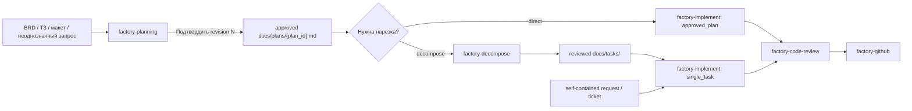
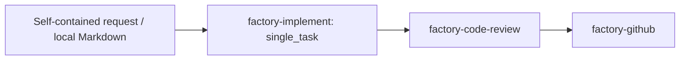

# AI-инструменты AniStar TV

Документ помогает выбрать AI-скилл и передать результат следующему этапу.
Внутренние контракты не дублируются: точные правила находятся в `SKILL.md` и
`references/` каждого пайплайна. Общие роли и контракты находятся в `.agents/`;
адаптеры поддерживают Codex и Claude Code.

`graphify` и `impeccable` — необязательные внешние навыки; их локальные
установки исключены из Git. Context7 — MCP-сервер, если подключён, а не
установленный скилл Factory.

## Быстрый выбор

| Задача | Скилл | Результат |
| :--- | :--- | :--- |
| Прояснить требования, поведение, границы или архитектурное решение | `factory-planning` | Подтверждённый план в `docs/plans/` |
| Разбить подтверждённый план на задачи | `factory-decompose` | Проверенные Markdown-задачи в `docs/tasks/` |
| Реализовать самостоятельную задачу или подтверждённый план | `factory-implement` | Код, тесты, проверки и внутреннее ревью |
| Проверить ветку, PR или модуль | `factory-code-review` | Замечания без изменения кода |
| Найти лишнюю сложность | `factory-code-simplify` | Предложения по упрощению без изменения кода |
| Создать PR, проверить checks, апрувы или merge | `factory-github` | Действие в GitHub |
| Обновить Flutter, FVM или packages | `anistar-flutter-update` | Обновлённые версии и проверки монорепозитория |
| Исследовать код и связи внутри проекта | `graphify`, если установлен | Карта существующей реализации |
| Проработать или улучшить интерфейс | `impeccable`, если установлен | Решение по UI/UX |
| Проверить актуальное API внешней библиотеки | Context7 MCP, если подключён | Выдержки из текущей документации |

Главное правило маршрутизации:

- неоднозначные требования идут в `factory-planning`;
- подтверждённый план идёт в `factory-decompose` или напрямую в `factory-implement`;
- самостоятельная задача, баг или точный запрос идут сразу в `factory-implement`;
- `factory-decompose` и `factory-implement` не меняют смысл подтверждённого источника.

Обычно следующий этап выбирает пользователь. Planning не запускает decomposition или
разработку, decomposition не публикует задачи, review не исправляет код.

## Основной процесс



Внутренний `dev-reviewer` входит в `factory-implement`. Отдельный
`factory-code-review` и GitHub-действия на схеме выполняются по запросу.

`handoff_recommendation: direct | decompose | either` в подтверждённом плане —
рекомендация. Обычно пользователь выбирает следующий скилл отдельно. Если он
заранее делегировал planning и уже попросил реализацию/декомпозицию, parent
orchestrator продолжает этот явно запрошенный шаг без второго checkpoint.

## 1. Смысловое планирование

Используйте `factory-planning`, если до исполнения нужно выбрать или уточнить:

- пользовательское поведение и ожидаемый результат;
- границы scope и совместимость;
- API, storage или другой контракт;
- архитектурную форму и владельца решения;
- acceptance, риски или готовность к разработке;
- один из нескольких значимо разных результатов.

Скилл проверяет требования по проекту и ведёт внутреннюю рабочую карту в
`.ai-pipeline/staging/planning-session.md`. После каждого ответа он проверяет
противоречия и влияние на behavior, scope, contracts, readiness и QA. Новые
зависимые вопросы остаются в той же session и не создают revision.

Когда все смысловые ветки решены или явно ограничены, Architect собирает
полный candidate. После semantic и deterministic preflight candidate становится
первой пользовательской `revision 1` в
`.ai-pipeline/staging/planning-plan.md`. В обычном режиме готовая revision
подтверждается отдельно:

```text
Подтвердить revision N
```

Команды `решай сам`, `на твоё усмотрение`, `вопросы не задавай` означают
delegated planning. Скилл сам выбирает рекомендуемые evidence-backed варианты,
прогоняет тот же impact scan/preflight/validator, создаёт revision и переводит
её в approved без паузы. В плане остаётся человекочитаемая строка с точной
директивой; новые machine metadata поля не добавляются. Это advance
authorization, не утверждение, что пользователь прочитал точный текст revision.

Подтверждённый immutable snapshot хранится в `docs/plans/{plan_id}.md`.
До первого promotion ответы и candidate-fixes revisions не расходуют. После
promotion смысловая правка создаёт новую revision; старое подтверждение на неё
не переносится. Machine-only и форматные исправления смысл не меняют и нового
approval не требуют.

Обычная самостоятельная задача не нуждается в церемониальном плане. Если
исходный запрос уже задаёт один наблюдаемый результат, scope и способ проверки,
его можно сразу передать в `factory-implement`.

Architect принадлежит `factory-planning`. `factory-implement` и `factory-decompose` его не
запускают.

`PLAN_READY` означает готовность смысловой карты, а не автоматическую
готовность всех capability к разработке. Если `EXT-*` задерживает реализацию,
план показывает readiness по затронутым `CAP-*` и точное условие старта.

Обычное завершение делегированной роли требует явного Done Signal и проверки
созданного ею файла. Восстановление после явного сбоя выполняется по правилам
конкретного скилла: например, planning допускает завершение того же candidate
главной сессией, если Architect недоступен или вернул невалидный результат.
Долгое выполнение или отсутствие новых сообщений само по себе не означает
ошибку. Агент не останавливается автоматически по таймеру; остановка нужна
только по просьбе пользователя, при явном сбое, блокировке или конфликте
одновременных изменений.

## 2. Декомпозиция подтверждённого плана

Передайте `factory-decompose` явный путь к approved plan, обычно
`docs/plans/{plan_id}.md`. Raw BRD, ТЗ или неподтверждённый draft не являются
валидным входом.

`factory-decompose`:

1. Проверяет approval metadata и фиксирует source hash.
2. Отображает `CAP-*` плана в вертикальные задачи.
3. Добавляет оценки, зависимости, blockers и deferred allocation.
4. Проверяет граф и task Markdown.
5. Собирает результат в `docs/tasks/`.

Задачи режутся по функциональному результату, не по слоям
`Domain → Data → Presentation`. Ориентир — 8 часов; цельная задача до 16 часов
допустима.

Planning approval уже авторизует смысл. `factory-decompose` не строит второй
семантический план и не просит подтвердить ещё одну revision. Пользователь может
попросить поправить формулировку или нарезку, пока она не меняет approved
semantics.

Если честная нарезка требует нового решения по поведению, scope, API,
архитектуре или acceptance, результат — `NEEDS_PLANNING`. Скилл сохраняет
staging evidence и возвращает gap в `factory-planning`; сам смысл не исправляет.

## 3. Разработка

`factory-implement` исполняет bounded source в одном из двух режимов:

| Mode | Вход | Правило |
| :--- | :--- | :--- |
| `single_task` | Прямой запрос, local task Markdown, Factory Decompose task | Выполнить один самостоятельный outcome без plan revision |
| `approved_plan` | Approved `docs/plans/{plan_id}.md` или валидная ссылка на него | Проверить approval tuple и выполнить выбранный plan scope без повторного approval |

Source kind и mode независимы: прямой запрос, локальная задача и ссылка на
approved plan сначала разрешаются до фактического источника.

`Без плана` и `решай сам` — разные команды.

- `Без плана` / `план не нужен` явно запрещает formal planning. Запрос идёт в
  `factory-implement` как `single_task`; новый mode и plan artifact не создаются.
- `Решай сам` / `делай сам` / `на твоё усмотрение` делегирует решения. Локальные
  choices остаются в `single_task`; настоящий material gap автоматически идёт
  через `factory-planning`, после чего исполнение продолжается по approved plan.

Если обе формулировки присутствуют, `без плана` имеет приоритет. Для прямого
execution pipeline выбирает project pattern, затем минимальное совместимое и
обратимое решение с сохранением security и данных.

Это делегирование решений, не фактов. Нельзя выдумывать backend/API contract,
credentials, поведение внешнего провайдера, compliance approval или ослаблять
TLS/auth/privacy. Для таких входов остаётся конкретный blocker. `factory-decompose`
по-прежнему принимает approved plan: если пользователь пропускает planning, он
запускает прямое исполнение через `factory-implement`, а не raw ТЗ → decomposition.

Перед production writes pipeline проверяет достаточность источника. Нужны один
наблюдаемый outcome или выбранная plan boundary, понятные in/out scope,
acceptance или способ проверки, известные blockers и отсутствие нерешённого
семантического выбора. Для маленького запроса достаточно обычного текста.

Для изменяемого источника pipeline фиксирует нормализованный `source_hash` и
`source_updated_at`, когда timestamp доступен. Непосредственно перед каждым
проходом Developer с production writes он перечитывает источник и сравнивает
hash и зафиксированный timestamp. Изменение возвращает `SOURCE_DRIFT` и требует
нового intake; ссылка не подменяет недостающий approval plan.

После Reality Check teamlead может создать
`.ai-pipeline/state/execution-brief.md`. Это non-semantic snapshot и checklist:

- provenance и source hash;
- неизменённые outcome, scope, acceptance и constraints;
- найденные code paths и существующие patterns;
- порядок правок и команды проверки;
- технические риски без нового смыслового решения.

`execution-brief.md` не содержит decision log, revision approval, выбора новой
архитектуры или придуманного acceptance. Он не является implementation plan и
не расширяет source.

`factory-implement` не запускает Architect, не создаёт `implementation-plan.md` и не
просит повторно подтвердить approved plan. Внутренние роли:
`code-explorer`, `bug-hunter`, `developer`, `test-writer`, `dev-reviewer` и
`doc-writer`.

Для начального запуска и `full_team` teamlead ведёт stateful pipeline и
делегирует работу каноническим ролям. Developer выполняет production-правки и
статический preflight; TestWriter владеет тестами; DevReviewer делает единое
внутреннее ревью и финальные Analyze/DCM/Format Check после всех правок.
Teamlead сериализует команды и проверяет evidence ролей.

Применимые финальные проверки выполняются последовательно из корня:

```bash
fvm dart run melos run check
fvm dart run melos run test:e2e
fvm dart run melos run build:android:prod:apk
```

В stateful pipeline первые две команды выполняет TestWriter, сборку — Developer.
Teamlead сам эти проверки не запускает. Flutter, Gradle и codegen выполняются
последовательно. Тесты пакетов находятся в корневом `test/`; точечный запуск:
`fvm flutter test <file> --reporter=failures-only`. Live tests и обновление golden
baselines требуют явного scope. Команды и ограничения описаны в
[Melos tooling](melos_tooling.md).

Для запроса после уже завершённого процесса сначала применяется
Post-Completion Follow-up Gate. `inline_self_review` допустим только для точно
зафиксированного нового delta в том же контексте и checkout, без активного или
возобновляемого pipeline/writer, с ясной проверкой и внутри ограничений скилла.
Изменения public API, DI, архитектуры, auth/security, storage/schema, сетевых
контрактов, navigation/lifecycle, concurrency, generated-контрактов или
межпакетных потребителей требуют `full_team`; число строк не определяет маршрут.
В `inline_self_review` root сам делает правки и focused tests, затем полный
workspace Analyze/DCM/Format Check, фиксирует хеши файлов и проверяет финальный
diff. Результат — `SELF_REVIEW PASS`; постоянные pipeline state и отчёты не
создаются. Любая новая правка требует повторить эту финальную проверку.

`NEEDS_PLANNING` — редкий safety valve, не реакция на любую неоднозначность.
Pipeline останавливает зависимые правки, только если одновременно:

1. выбор материально меняет observable behavior, public contract, security,
   acceptance, scope или outcome;
2. source, код и project patterns не дают ответа;
3. варианты имеют разные нелокальные, необратимые или compatibility последствия;
4. выбор нельзя безопасно оставить локальным, обратимым execution-решением без
   formal planning.

Иначе pipeline выбирает ограниченный вариант, фиксирует основание и продолжает.
Если все четыре условия выполнены, `решай сам` запускает delegated planning;
`без плана` или отсутствие делегирования возвращает terminal gap.
Исследовательские агенты возвращают evidence-кандидат; финальную классификацию
делает teamlead.

```text
NEEDS_PLANNING
Source: {source_ref} ({single_task|approved_plan})
Evidence: {конфликт или недостающее утверждение}
Missing decision: {одно конкретное решение}
Directive: none | no_plan | delegated_planning
Routing: terminal gap | Factory Planning handoff | factual blocker
Production writes: none | stopped; existing diff preserved
```

Gap передаётся в `factory-planning`. Возобновление возможно с новым
self-contained source либо валидным approved plan tuple.

## 4. Независимая проверка кода

`factory-code-review` проверяет ветку, PR или отдельный модуль, но не исправляет код.
Главная сессия фиксирует набор изменений и запускает подходящие анализаторы,
тесты и проверку зависимостей. Затем три независимых ревьюера проверяют направления с учётом доступной
конкурентности — параллельно, волнами или последовательно:

- `system-design` — соответствует ли решение задаче и архитектуре проекта;
- `runtime-safety` — корректность, ошибки, асинхронность и безопасность;
- `verification-quality` — тесты и удобство дальнейшей поддержки.

После QA-проверки результатов и структурной валидации формируется один локальный
отчёт для чата и возможного PR.
Незавершённая проверка получает статус `INCOMPLETE`, но подтверждённые замечания
не теряются. Публикация комментария в GitHub требует явного поручения
пользователя. Старые форматы отчётов не поддерживаются.

## Самостоятельная задача, баг или рефакторинг

Запускайте сразу `factory-implement`, когда исходник задаёт одну цельную задачу:
исправление бага, локальное изменение UI, behavior-preserving refactor или
небольшую фичу с ясным результатом.



Количество файлов не делает запрос semantic plan. Планирование нужно, когда
необходимо принять смысловое решение или разделить несколько независимых
outcome, а не когда teamlead ещё не знает имена файлов и порядок правок.

## Границы ответственности

| Скилл | Владеет | Не делает |
| :--- | :--- | :--- |
| `factory-planning` | Goal, behavior, scope, solution shape, decisions, contracts, readiness, revision и approval | Не режет tickets, не оценивает их, не реализует и не публикует |
| `factory-decompose` | Task IDs, vertical slices, estimates, dependencies, blockers и reviewed `docs/tasks/` | Не принимает semantic decisions, не создаёт второй approval, не пишет код |
| `factory-implement` | Source intake, code Reality Check, execution preparation, implementation, tests, review и fix loops | Не меняет source semantics, не запускает Architect, не выполняет GitHub-операции |
| `factory-code-review` | Независимая проверка ветки, PR или модуля тремя ревьюерами и единый итоговый отчёт | Не исправляет проблемы и не публикует комментарий в PR без отдельного выбора |
| `factory-code-simplify` | Поиск YAGNI, дублей и пропущенного reuse | Передаёт применение выбранных правок в `factory-implement`; уже данная авторизация достаточна |
| `factory-github` | PR, checks, comments, approvals и merge по запросу | Не проводит полноценное code review |

## Артефакты и состояние

| Место | Назначение | Срок жизни |
| :--- | :--- | :--- |
| `.ai-pipeline/staging/planning-session.md` | Внутренняя рабочая карта фактов, решений, вопросов, противоречий и impact | Сохраняется transactionally; downstream её игнорирует |
| `.ai-pipeline/staging/planning-plan.md` | Текущая preflight-clean пользовательская revision `factory-planning` | Сохраняется до approval, изменения или отмены |
| `docs/plans/{plan_id}.md` | Immutable approved semantic plan | Остаётся в репозитории |
| `.ai-pipeline/staging/` | Drafts и внутренние envelopes `factory-decompose` | Временно по правилам decomposition pipeline |
| `docs/tasks/` | Reviewed task package с provenance approved plan | Остаётся в репозитории |
| `.ai-pipeline/state/pipeline.md` и отчёты разработки | Ход выполнения, результаты проверок и данные для продолжения `factory-implement` | Временно; удаляется после завершения или отмены процесса |
| `.ai-pipeline/state/review-*.json`, `review-final.md` | Промежуточные результаты и итоговый отчёт `factory-code-review` | Временно; старые форматы не импортируются |

## Подтверждения человека

| Этап | Что подтверждается | Команда или действие |
| :--- | :--- | :--- |
| Вопросы `factory-planning` | Отдельные решения рабочей session | Выбор ответа или свободный текст; это не approval и не revision plan |
| План `factory-planning` | Полная текущая semantic revision | `Подтвердить revision N` |
| `factory-decompose` | Нет второй semantic approval | Reviewed tasks возвращаются как результат; возможен запрос edits |
| `factory-implement` | Нет нового approval plan | Implementation request авторизует только locked `single_task` или approved scope |
| GitHub write, commit или push | Конкретная операция | Явное поручение пользователя; существующая авторизация достаточна |

## Когда этап завершён

| Этап | Признак готовности |
| :--- | :--- |
| Planning | Текущая revision validated, approved явно или по delegated authorization и сохранена в `docs/plans/` |
| Decomposition | Все tasks покрывают approved capabilities; graph и review прошли |
| Development | Код и tests готовы; применимые обязательные gates прошли; review закрыт. Blocker означает незавершённый этап |
| Code review | Все три направления проверены, результаты команд учтены, итоговый отчёт показывает `COMPLETE` либо честно объясняет `INCOMPLETE` |
| PR задачи в согласованном стеке | Изменение проверено и влито в согласованную ветку без squash, сохраняя SHA зависимостей |
| Готовая фича | Все обязательные slices сведены; temporary behavior закрыто; итоговый review выполнен |
| Вливание в `main` | Поведение и acceptance завершены; обязательной deferred-работы нет; актуальные проверки и review учтены |

## Ветки и squash

Основная ветка — `main`. Для обычной задачи используются осмысленные
`feature/`, `fix/`, `chore/` или `codex/` ветки от актуального `main`.
Стек веток нужен только при явно согласованной работе стеком.

| Откуда | Куда | Merge |
| :--- | :--- | :--- |
| Обычная feature/fix/tooling ветка | `main` | Squash допустим для одной логической задачи |
| Задача явно согласованного стека | Согласованная feature/integration ветка | Без squash, с сохранением SHA зависимостей |

База и цель каждой PR в стеке согласуются явно. Коммит и заголовок PR:
`type(scope): description`; scope — реальный пакет или `root`, для feature-модулей
— `anistar_tv`. ID задачи добавляется только при наличии такой задачи.
Commit, push, публикация PR/comment/review, merge и release требуют явного
поручения пользователя. Существующая авторизация достаточна.

В AniStar TV CI/CD не настроен: отсутствие remote checks не заменяет локальные
проверки. Перед merge проверяются актуальные head SHA, target, состояние PR,
реальные требования репозитория и свежие результаты применимых проверок.

Полные правила: [Стратегия ветвления и слияния](vcs_guidelines.md).

## Проверка и исследование

| Нужно проверить | Используйте |
| :--- | :--- |
| Архитектуру, корректность, безопасность и tests текущих изменений | `factory-code-review` |
| Лишние abstractions, дубли, YAGNI и пропущенный reuse | `factory-code-simplify` |
| Поток выполнения и связи внутри AniStar TV | Необязательный внешний `graphify` и локальные файлы |
| Текущее API Flutter, Dart или внешнего package | Context7 MCP, если подключён |

## Примеры запросов

Пути планов и задач ниже — гипотетические примеры, а не существующие артефакты.

```text
Спланируй через factory-planning возобновление HLS-воспроизведения. Сверь
behavior, API boundary и verification. Ничего не запускай до подтверждения revision.
```

```text
Разбей через factory-decompose approved plan docs/plans/playback-resume.md на
вертикальные задачи AniStar TV с оценками и dependencies.
```

```text
Реализуй approved plan docs/plans/playback-resume.md напрямую через
factory-implement. Execution mode: approved_plan.
```

```text
Реализуй docs/tasks/catalog/catalog-pagination-01.md через factory-implement.
Execution mode: single_task.
```

```text
Исправь через factory-implement баг: после возврата из плеера теряется фокус
выбранного элемента избранного.
Найди root cause и добавь regression test.
```

## Если процесс остановился

| Ситуация | Что делать |
| :--- | :--- |
| `factory-planning` ждёт вопрос | Ответить вариантом или фактом; агент обновит session, проверит противоречия и при необходимости задаст следующую ветку без revision |
| `factory-planning` ждёт approval | Подтвердить точную текущую revision либо запросить изменения |
| `factory-decompose` вернул `NEEDS_PLANNING` | Передать gap и evidence в `factory-planning`; после новой approved revision повторить decomposition |
| `factory-implement` вернул `NEEDS_PLANNING` | Не просить pipeline угадать; подготовить новый self-contained source или approved plan |
| `factory-implement` вернул `BLOCKED_NO_APPROVED_PLAN` | Передать валидный immutable plan и approval tuple |
| Pipeline вернул `BLOCKED_AGENT_FAILURE` | Возобновить из указанного source lock/checkpoint; не удалять staging/state и не запускать параллельного writer вручную |
| Найден старый execution pipeline | Выбрать `resume` либо `fresh start`; не удалять runtime-файлы вручную |
| Изменяемый source изменился (`SOURCE_DRIFT`) | Выполнить новый intake; при semantic gap вернуться в `factory-planning` |
| Проверка не выполнена из-за окружения | Не считать задачу готовой; зафиксировать blocker и требуемое действие |
| Graphify показывает устаревшие связи | Выполнить `graphify update .` |
