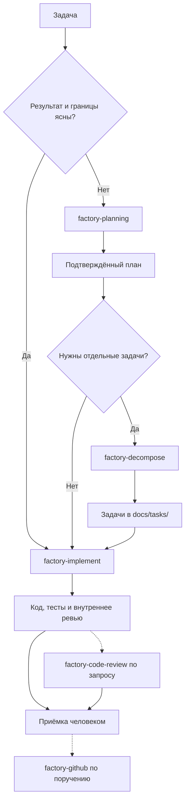

# 🤖 AI Software Factory | AniStar TV

AniStar TV: личный некоммерческий пет-проект и площадка для демонстрации
AI Software Factory. Здесь агентам поручают подготовку задач, реализацию,
написание тестов и проверку изменений. Человек задаёт цель, принимает
существенные решения и проверяет результат.

Это руководство объясняет, как пользоваться фабрикой в этом репозитории.
Точные инструкции исполнителей находятся в `.agents/`: они задают границы
каждого этапа и способы проверки его результата.

## Содержание

- [Как устроена фабрика](#1-как-устроена-фабрика)
- [Где лежат настройки](#2-где-лежат-настройки)
- [С чего начать задачу](#3-с-чего-начать-задачу)
- [Как подготовить запрос](#4-как-подготовить-запрос)
- [Планирование и декомпозиция](#5-планирование-и-декомпозиция)
- [Разработка и цикл исправлений](#6-разработка-и-цикл-исправлений)
- [Независимое ревью](#7-независимое-ревью)
- [Другие инструменты](#8-другие-инструменты)
- [Приёмка и разрешения](#9-приёмка-и-разрешения)
- [Сохранение работы и остановки](#10-сохранение-работы-и-остановки)

---

## 1. Как устроена фабрика

У фабрики есть повторяемый рабочий цикл: разобраться в задаче, изменить код,
написать тесты, запустить проверки, провести ревью и исправить замечания.
Оркестратор передаёт работу между исполнителями и следит, чтобы следующий
этап получил нужные материалы.

| Понятие | Что означает |
| --- | --- |
| **Скилл** | Инструкция для определённого вида работы: например, планирования или ревью. Может описывать целый процесс с несколькими агентами |
| **Агент** | Исполнитель с отдельной ролью, задачей и контекстом |
| **Оркестратор** | Главная сессия, которая выбирает процесс, передаёт задачи агентам и проверяет их результаты |
| **Контекст** | Требования, ограничения, исходники и документы, необходимые для конкретной задачи |
| **Критерии приёмки** | Наблюдаемое поведение, по которому можно проверить результат |
| **Definition of Done** | Условия завершения работы: согласованный объём выполнен, нужные проверки пройдены, замечания разобраны |

### Зачем нужны отдельные роли

Автор реализации и автор тестов смотрят на задачу с разных сторон.
Разработчик выбирает способ реализовать поведение, а автор тестов проверяет
требования и граничные случаи. Это уменьшает риск получить тесты, которые
только повторяют уже написанный код.

Ревьюер дополнительно проверяет связи между частями приложения: например,
не открывает ли запоздалый ответ данные прежнего аккаунта и освобождается ли
native controller при выходе из плеера. Одного успешного запуска тестов для
таких выводов может быть недостаточно.

Разделение контекста помогает сосредоточить исполнителя на своей части
работы. Ему нужны исходная задача и относящиеся к ней материалы. Длинная
история всех предыдущих попыток может мешать. При этом отдельные агенты
могут повторить одну и ту же ошибку. Поэтому результат требует проверки.

Состав команды зависит от процесса. Планирование, декомпозиция и независимое
ревью кода представляют собой отдельные инструменты. Для понятного исправления не нужно
сначала проходить все этапы большой фичи.

---

## 2. Где лежат настройки

```text
.agents/
├── agents/       # Описания ролей
├── contracts/    # Входы, границы работы и признаки завершения
├── skills/       # Сценарии Factory и их скрипты
└── adapters/     # Работа с инструментами Codex и Claude Code

.codex/agents/    # Настройки ролей для Codex
.claude/agents/   # Настройки ролей для Claude Code
.claude/skills/   # Подключение скиллов в Claude Code

.ai-pipeline/    # Временные материалы выполняемой задачи
docs/plans/      # Подтверждённые планы
docs/tasks/      # Проверенные задачи
```

Общие роли и правила находятся в `.agents/`. Файлы среды подключают эти
инструкции к конкретному инструменту. Настройки моделей и уровня размышления
для Codex находятся в `.codex/agents/*.toml`. Для Claude Code эти настройки
находятся в его обёртках и адаптере. Назначение модели определяется ролью.
Актуальные значения смотрите в настройках ролей.

Основные роли:

| Роль | Ответственность |
| --- | --- |
| `code-explorer` | Исследует существующий код и его связи |
| `bug-hunter` | Ищет причину сбоя и собирает подтверждения |
| `architect` | Готовит план решения внутри `factory-planning` |
| `task-decomposer` | Разбивает подтверждённый план на задачи |
| `task-reviewer` | Проверяет и уточняет декомпозицию |
| `developer` | Меняет рабочий код |
| `test-writer` | Пишет и запускает тесты |
| `dev-reviewer` | Проводит внутреннее ревью реализации |
| `reviewer` | Проверяет одно направление независимого code review |
| `doc-writer` | Обновляет документацию |

Инструкции читаются вместе с [правилами проекта](../AGENTS.md),
[архитектурой](01_architecture_principles.md) и подходящими
[спецификациями](specs/README.md). Приоритеты поведения приложения берутся
из этих документов и задания пользователя.

Для начала откройте корень репозитория в своей агентской среде. Убедитесь,
что она обнаружила нужные скиллы. Можно попросить: «Покажи доступные Factory
скиллы этого проекта и подскажи, какой подходит моей задаче». Graphify,
Impeccable и MCP-подключения проверяются отдельно. Их наличие на одном
компьютере не означает, что они установлены у другого участника.

---

## 3. С чего начать задачу

Можно написать обычный запрос и назвать нужный скилл. В среде, которая
поддерживает такой вызов, используйте форму `$factory-implement ...`.
Примеры ниже: сообщения агенту, а не команды терминала.

| Что нужно получить | С чего начать |
| --- | --- |
| Проверить, установить или обновить окружение, skills и инструменты | `factory-install` |
| Выбрать поведение, границы или архитектуру будущего изменения | `factory-planning` |
| Разбить уже подтверждённый план на задачи | `factory-decompose` |
| Реализовать понятную задачу, исправить баг или выполнить план | `factory-implement` |
| Проверить изменения без исправления кода | `factory-code-review` |
| Найти лишнюю сложность и возможности упрощения | `factory-code-simplify` |
| Подготовить PR, проверить GitHub checks или выполнить согласованное Git-действие | `factory-github` |
| Обновить Flutter и зависимости | `anistar-flutter-update` |
| Понять существующий поток данных или зависимости | `graphify`, если установлен |
| Проверить или улучшить интерфейс | `impeccable`, если установлен |



Большой набор изменений удобнее принимать частями. Завершите одну задачу,
посмотрите diff и результат проверок, разберите замечания, затем переходите
к следующей. Размер итерации должен позволять человеку понять и проверить
изменение.

---

## 4. Как подготовить запрос

Хороший запрос объясняет результат, текущую проблему и способ проверки.
Перечислять все будущие файлы и классы заранее необязательно: их расположение
агент выясняет по проекту.

Например:

```text
Через factory-implement исправь потерю фокуса в избранном после возврата
из плеера.

Ожидаю: Back возвращает к выбранной карточке и прежней позиции списка.
Если карточка исчезла, фокус должен остаться на доступном элементе.

Сохрани текущие правила короткого и долгого OK. Найди причину сбоя,
добавь регрессионную проверку и покажи выполненные проверки и ограничения.
```

Здесь есть сценарий, ожидаемый результат, исключение и граница изменения.
Фразу «исправь фокус» пришлось бы сначала уточнять.

Для новой функции полезно указать:

- кто и в какой ситуации ей пользуется;
- что должно произойти при успехе и при отказе;
- что входит в задачу и что остаётся за её пределами;
- какие действующие правила нужно сохранить;
- как человек проверит результат.

### Проверка постановки до разработки

Если описание расходится с кодом или не объясняет важный сценарий,
`factory-planning` сопоставляет его с реализацией, спецификациями и ADR.
Так можно заранее обнаружить недостающий контракт, противоречивое поведение
или внешнюю зависимость.

В AniStar TV для этого важны контракт `AnistarClient`, HTML-протокол,
origin-bound сессии и native playback. Неизвестное поведение сайта требуется
исследовать или уточнить. Агент не должен придумывать ответ внешней системы.

---

## 5. Планирование и декомпозиция

### Когда нужен план

`factory-planning` помогает, когда возможны несколько существенно разных
решений. Например, для новой функции продолжения просмотра нужно определить,
что сохраняется и как учитывается аккаунт. Также нужно определить, когда
показывать предложение продолжить просмотр и что делать, если сохранённая
серия недоступна.

Это учебный пример будущей функции, а не описание уже реализованной возможности.

План объясняет поведение, границы ответственности, выбранное решение, риски
и способ проверки. Он может содержать схему или псевдокод, если это помогает
понять решение. В обычном режиме пользователь читает полную версию и подтверждает
её:

```text
Подтвердить revision N
```

Подтверждённый план сохраняется в `docs/plans/{plan_id}.md`.
Существенное изменение решения создаёт новую revision. Подтверждение прежнего
варианта на неё не переносится. План должен явно указывать недостающие внешние
данные или блокирующие условия.

### Зачем отдельно разбивать план на задачи

Подтверждённый план можно сразу передать в `factory-implement`.
`factory-decompose` нужен, если работу удобнее выполнять и принимать
отдельными частями.

```text
Через factory-decompose разбей подтверждённый план
docs/plans/playback-resume.md на проверяемые задачи.
Укажи зависимости, порядок, оценки и критерии готовности.
```

Пути `playback-resume.md` здесь и далее служат условными примерами.

**Вертикальный слайс** даёт проверяемый результат через нужные слои приложения.
Для продолжения просмотра одна часть может включать сохранение позиции,
её чтение для того же аккаунта, действие в интерфейсе и тесты этого сценария.
Перенос отдельных моделей или создание repository без подключения к сценарию
ещё не даёт такой результат.

Задача должна указывать цель, границы, проверки, критерии приёмки, Definition
of Done, зависимости и условие начала работы. Ориентир оценки: около 8 часов.
Цельная задача длительностью до 16 часов допустима. Это ориентиры декомпозиции,
а не обещание срока работы агента.

`task-decomposer` готовит задачи, `task-reviewer` проверяет их смысл и
выполнимость, скрипты проверяют структуру и зависимости. Итог находится в `docs/tasks/`.
Декомпозиция не требует второго согласования смысла уже подтверждённого плана.
Если при разбиении требуется новое решение, его возвращают в планирование.

### Как передать агенту больше самостоятельности

Фраза «сам спланируй и реализуй» разрешает выбрать решение и продолжить
запрошенную разработку после проверенного плана. Формулировки «решай сам»,
«на твоё усмотрение» и «вопросы не задавай» могут делегировать существенные
решения. Оркестратор и так решает локальные технические вопросы по проектным
правилам. Самостоятельное планирование сохраняет проверку и фиксацию плана.

Фраза «без плана» явно исключает формальное планирование. Она подходит для
ограниченной понятной задачи. Если пользователь одновременно говорит «решай сам»
и «без плана», действует «без плана». Если остаётся существенный выбор, который
нельзя безопасно решить в этих границах, агент должен объяснить, чего не хватает.

Делегирование не разрешает выдумывать факты, ослаблять защиту данных
или выходить за согласованный объём. Точные правила:
[factory-planning](../.agents/skills/factory-planning/SKILL.md) и
[factory-decompose](../.agents/skills/factory-decompose/SKILL.md).

---

## 6. Разработка и цикл исправлений

`factory-implement` принимает самостоятельный запрос, локальную Markdown-задачу
или подтверждённый план. Небольшое исправление с ясным результатом можно
передать сразу:

```text
Через factory-implement выполни задачу из docs/tasks/playback/resume-01.md.
Сохрани границы задачи и проверь указанные критерии приёмки.
```

Это пример пути к задаче. Для реального запуска укажите существующий файл.

В отчётах `single_task` означает исполнение одной самостоятельной задачи.
`approved_plan` означает работу по подтверждённому плану. Уже подтверждённое
решение не нужно согласовывать заново при каждой передаче следующему этапу.

Внутри процесса оркестратор:

1. Проверяет задание и собирает нужный контекст. При необходимости подключает
   `code-explorer` или `bug-hunter`.
2. Передаёт реализацию `developer`. Разработчик выполняет статические проверки
   своих изменений перед передачей дальше.
3. Передаёт проверку поведения `test-writer`, который пишет и запускает тесты.
4. Подключает `dev-reviewer`: он сверяет результат с заданием, архитектурой,
   правилами и тестами, выполняет финальные статические проверки.
5. Возвращает значимые замечания владельцу кода или тестов и проверяет
   исправления. Число повторов ограничено правилами выбранного процесса.

Роли разделены в обычном процессе с командой. Для некоторых ограниченных
правок после уже завершённой задачи предусмотрен режим `inline_self_review`.
Условия этого режима задаёт скилл. Он не делает любые короткие изменения
исключением из основного процесса.

Детерминированные проверки дают быструю обратную связь: форматирование,
Analyzer, DCM, тесты, проверки структуры и зависимостей. AI-ревью дополняет
их проверкой смысла, полноты и взаимодействия частей приложения.

Применимый полный порядок проверок кода:

```bash
fvm dart run melos run check
fvm dart run melos run test:e2e
fvm dart run melos run build:android:prod:apk
```

В процессе с командой `check` и fixture E2E выполняет `test-writer`.
APK собирает `developer`. Flutter, Gradle и генерация выполняются последовательно.
Live-тесты и обновление golden baselines требуют явно заданного объёма работ.

Команды и ограничения находятся в [Melos tooling](melos_tooling.md) и
[руководстве тестирования](05_development_and_testing.md). Точные маршруты,
условия повторов и состав проверок:
[factory-implement](../.agents/skills/factory-implement/SKILL.md).

---

## 7. Независимое ревью

Внутреннее ревью `dev-reviewer` входит в разработку. Отдельный
`factory-code-review` позволяет проверить ветку, PR или область проекта
самостоятельно, в том числе перед приёмкой большого изменения.

```text
Через factory-code-review проверь текущую ветку относительно main.
Сверь реализацию с исходной задачей и связанными спецификациями.
Покажи подтверждённые проблемы и какие проверки удалось выполнить.
Код пока не меняй.
```

### Как проходит проверка

Сначала главная сессия определяет набор изменений и запускает подходящие
локальные инструменты: статический анализ, тесты и проверки зависимостей.
Затем три независимых ревьюера разбирают разные направления:

| Направление | Что проверяет |
| --- | --- |
| `system-design` | Соответствие задаче, архитектуре, границам слоёв и контрактам |
| `runtime-safety` | Поведение во время выполнения, ошибки, асинхронность, lifecycle и безопасность |
| `verification-quality` | Проверки поведения, регрессии и качество подтверждений результата |

Агенты могут работать параллельно, волнами или последовательно. Выбор зависит
от доступных ресурсов. Направления и независимость проверок сохраняются.

Главная сессия выполняет роль судьи: перепроверяет основания замечаний,
разбирает повторы, проверяет критичность и сводит результат. Отдельный
структурный валидатор проверяет согласованность отчёта и результатов команд.
В текущем процессе эта роль не требует отдельного агента или модели другого
производителя.

### Как читать замечания

**Критичность** показывает последствия подтверждённой проблемы.
**Уверенность** показывает, насколько обоснован вывод проверяющего.
Текущие категории уверенности: `high` и `medium`. Это оценки агента,
а не измеренная вероятность ошибки.

У полезного замечания есть место в коде, условие возникновения, влияние
на поведение и подтверждение. Если ожидаемый сценарий не указан в задаче,
проверяющий не должен подменять его собственным предположением.

Полнота проверки и оценка кода учитываются отдельно. `INCOMPLETE` означает,
что часть необходимых проверок не выполнена или результат нельзя подтвердить.
Падающая выполненная проверка учитывается как ошибка. Её нельзя превратить
в одобрение. Подтверждённые замечания сохраняются и при неполном ревью.

В итоговой оценке `APPROVE` означает одобрение проверенного изменения,
`NEEDS_WORK` означает необходимость исправлений, `RETHINK` означает существенный вопрос
к решению, который нужно разобрать. `COMPLETE` показывает полноту собранных
результатов и может сопровождать `NEEDS_WORK`.

После исправлений повторное ревью относится уже к обновлённому коду.
Несколько проходов помогают проверить правки, но не гарантируют отсутствие
всех ошибок.

`factory-code-review` выдаёт локальный результат. Исправление кода и публикация
комментариев в GitHub требуют отдельных действий. Инструкции и формат отчёта:
[factory-code-review](../.agents/skills/factory-code-review/SKILL.md).

---

## 8. Другие инструменты

**`factory-install`** проверяет, устанавливает и обновляет окружение на macOS, Windows и Linux:
FVM и закреплённый Flutter, Android SDK, Python, DCM, GitHub CLI, security CLI,
Lefthook, внешние skills и MCP. Сначала скилл анализирует существующие компоненты,
версии и настройки, затем показывает краткий отчёт: что оставить, установить,
обновить или восстановить. Пользователь выбирает состав и подтверждает список.
До этого установки, обновления и изменения настроек не выполняются.
Полный комплект включает Graphify с локальным патчем, построение графа и Impeccable.
На macOS используется Homebrew.
На Windows скилл различает WSL2 и native toolchain и отдельно проверяет Android
emulator, Bash scripts и пути запуска MCP.

```text
Через factory-install проверь окружение и предложи список установок и обновлений.
```

Ненужные компоненты можно исключить. Повторный запуск учитывает существующие
установки и выполненные действия. Для диагностики без изменений напишите
«Через factory-install проверь окружение без установки».
Подтверждённое обновление Flutter, Melos или pub dependencies скилл проводит
через `anistar-flutter-update`, сохраняя согласованный объём.
Порядок и платформенные инструкции: [Factory Install](../.agents/skills/factory-install/SKILL.md).

**`factory-code-simplify`** ищет дубли, лишние абстракции и возможности
переиспользования. По умолчанию возвращает предложения без правок.
Если пользователь поручил применить выбранные изменения, реализация идёт
через `factory-implement` с сохранением поведения.

```text
Через factory-code-simplify проверь data layer каталога.
Покажи, что можно удалить или переиспользовать без изменения поведения.
```

**`factory-github`** выполняет согласованные Git/GitHub-действия:
подготавливает PR, читает checks и комментарии, выполняет публикацию или merge.
Перед этими действиями скилл сверяется с текущим состоянием репозитория
и свежими результатами проверок.
Правила веток, squash и версий вынесены в [VCS](vcs_guidelines.md).

**`anistar-flutter-update`** обновляет FVM pin, SDK и зависимости workspace,
учитывает ограничения resolver и запускает проверки с Android-сборкой.
Результаты конкретного запуска идут в итоговый ответ. Руководства обновляются,
когда меняются рабочие правила.

**Context7**: подключаемый MCP-сервер для актуальной документации библиотек.
Он помогает проверить внешнее API, а устройство этого приложения нужно
устанавливать по исходникам, спецификациям и ADR.

Повторяющиеся замечания людей к PR полезно превращать в явные правила:
описать пропущенный случай, дополнить инструкцию и проверить её на следующих
задачах. Так опыт приёмки помогает улучшать сам процесс. Изменение инструкций
оформляется отдельной задачей.

### Дополнительные инструменты

Graphify и Impeccable необязательны для работы фабрики. `factory-install`
предлагает оба инструмента в полном комплекте; состав выбирается до согласия
на установку или обновление.

**Graphify** строит граф связей кода и документации. Крайне рекомендуется
для навигации по проекту и понимания зависимостей между его частями.
[Документация и установка](https://github.com/Graphify-Labs/graphify#readme).

**Impeccable** помогает оценивать и улучшать UI/UX: структуру экранов,
читаемость и визуальное оформление.
[Документация и установка](https://impeccable.style/docs/).

---

## 9. Приёмка и разрешения

Принимайте изменение по ожидаемому поведению и свежим подтверждениям.
Полезный итоговый ответ объясняет, что изменилось, почему, какие команды
завершились успешно и что осталось непроверенным. Правила оформления:
[результаты и границы проверки](05_development_and_testing.md#10-результаты-и-границы-проверки).

Для задачи проверьте:

1. Реализован ли весь согласованный сценарий, включая отказы и исключения.
2. Относятся ли результаты проверок к текущим исходникам и конфигурации.
3. Проверены ли существенные замечания ревью и сами исправления.
4. Понятны ли ограничения: fixture, live-сайт, эмулятор и физическое устройство
   подтверждают разные вещи.

Коммит, push, публикация PR или комментария, merge и release требуют явного
поручения. Наличие локального кода или положительного ревью само по себе
не разрешает эти действия. Разрешение на конкретное действие, выданное ранее,
не требует повторного подтверждения.

Обычный процесс планирования ждёт подтверждения полной revision. При заранее
делегированных решениях агент может пройти этот этап самостоятельно и
продолжить уже запрошенную работу. Декомпозиция готового approved plan
не просит повторно подтверждать тот же смысл.

---

## 10. Сохранение работы и остановки

Файлы помогают продолжать работу между сессиями. Подтверждённые планы
и проверенные задачи остаются в `docs/plans/` и `docs/tasks/`.
Промежуточные сведения нужны только для текущего процесса:

| Место | Что хранит |
| --- | --- |
| `.ai-pipeline/staging/planning-session.md` | Рабочие вопросы, факты и решения планирования |
| `.ai-pipeline/staging/planning-plan.md` | Текущую версию плана перед подтверждением |
| `.ai-pipeline/staging/tasks/` | Черновики декомпозиции |
| `.ai-pipeline/state/pipeline.md` | Этап разработки и данные для возобновления |
| `.ai-pipeline/state/review-final.md` | Локальный итог независимого ревью |

Оркестратор проверяет результат роли перед переходом дальше и удаляет
служебные файлы по правилам процесса. При блокировке или прерывании
нужные данные для продолжения сохраняются. Временное состояние не нужно
копировать в постоянную документацию или превращать в журнал всех запусков.

Служебные `run_id` и `source_hash` связывают отчёт с конкретной задачей и её
версией. Они помогают заметить изменение исходного задания, но не доказывают
качество кода. Обычно пользователю достаточно результата и причин остановки.
Схемы этих полей находятся в контрактах.

| Что произошло | Что делать |
| --- | --- |
| Агент задаёт вопрос по требованиям | Уточнить поведение или передать недостающий факт |
| Готов план revision N | Подтвердить эту версию либо перечислить изменения |
| `NEEDS_PLANNING` | Уточнить существенное решение и вернуть задачу в планирование |
| `BLOCKED_NO_APPROVED_PLAN` | Передать действующий подтверждённый план |
| `SOURCE_DRIFT` | Перечитать изменившееся задание и заново зафиксировать источник |
| `BLOCKED_AGENT_FAILURE` | Продолжить с сохранённого этапа по указанным условиям восстановления |
| Найден незавершённый процесс | Явно выбрать продолжение или новый запуск. Не удалять состояние вручную |
| Недоступны SDK, устройство или обязательная проверка | Устранить конкретную причину. Не считать непроведённую проверку успешной |

Если работа долго не даёт видимого результата, можно запросить текущий этап
или явно остановить её. Не запускайте второго исполнителя поверх тех же
файлов. Само отсутствие сообщений не доказывает сбой. Текущие правила
ожидания и восстановления заданы
[контрактом контрольных точек](../.agents/contracts/common/agent-checkpoint.md).

Технические детали:
[правила скиллов](../.agents/skills/),
[контракты ролей](../.agents/contracts/),
[адаптер Codex](../.agents/adapters/codex.md) и
[адаптер Claude Code](../.agents/adapters/claude.md).
