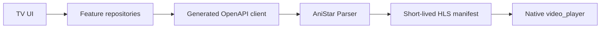

# Архитектура

## Обзор

AniStar TV — Flutter-клиент для Android TV. Он получает каталог и HLS-сессии только через AniStar Parser; клиент не парсит HTML и не работает с прямыми CDN-ссылками.

## Модули

| Путь | Ответственность |
| --- | --- |
| `lib/app/` | композиция зависимостей и typed routes |
| `lib/packages/core/api/` | URL parser и сетевые ошибки |
| `lib/packages/features/catalog/` | каталог и пагинация |
| `lib/packages/features/anime/` | детали аниме и список серий |
| `lib/packages/features/player/` | новая playback-сессия и TV-контролы |
| `lib/packages/ui_kit/` | тема, focus-состояния и общие виджеты |
| `packages/anistar_api/` | сгенерированные DTO и OpenAPI-вызовы |

## Основной сценарий

1. Каталог запрашивает страницу аниме, показывает адаптивную сетку и открывает выбранную карточку.
2. Экран аниме параллельно получает детали и серии; первый фокус находится на действии просмотра в hero-блоке.
3. Перед каждым просмотром player запрашивает новую playback-сессию.
4. `video_player` открывает HLS-манифест parser и показывает controls для пульта.
5. При ошибке воспроизведения пользователь создаёт новую сессию; старый URL не используется.

## Управление на TV

- Каталог и серии используют обычную Flutter focus-систему: стрелки перемещают фокус, `OK` открывает карточку.
- На экране аниме `OK` запускает первую серию, а `↓` переводит пользователя к полной сетке серий.
- Сетка меняет число колонок по доступной ширине и прокручивает сфокусированную карточку в видимую область.
- В player `←/→` перематывают на 10 секунд, `OK` и media play/pause переключают воспроизведение.
- Все экраны учитывают safe area и оставляют увеличенные отступы под TV overscan.
- Android-сборка объявляет Leanback launcher, landscape-режим и отсутствие обязательного touchscreen.

## Границы

- Presentation не знает об upstream, CDN и формате OpenAPI DTO.
- Репозитории переводят transport DTO в модели приложения и нормализуют сетевые ошибки.
- Сгенерированный клиент не редактируют вручную.
- Сессия и `manifest_path` не сохраняются на устройстве.

Значимое решение зафиксировано в [ADR-0001](adr/0001-use-anistar-parser-openapi.md).
