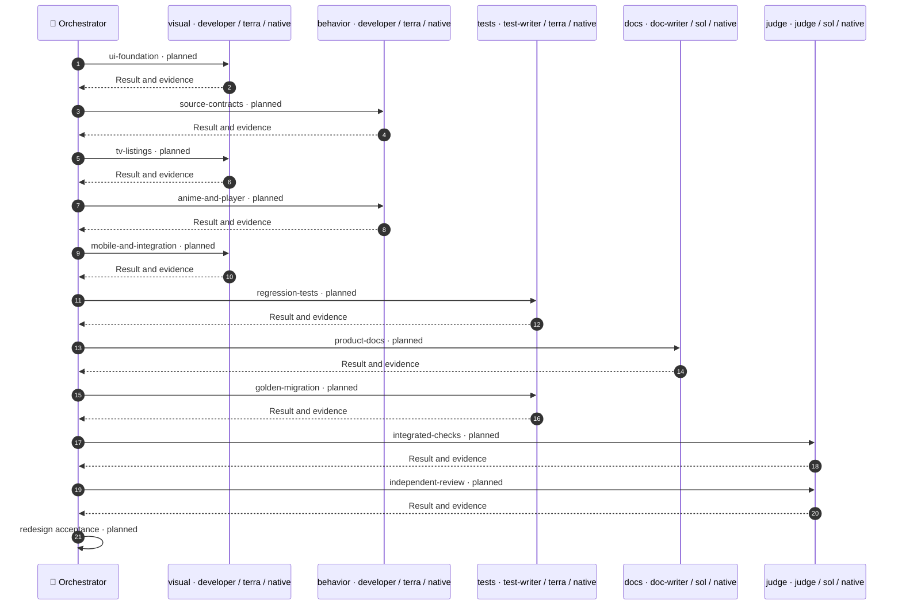

# Execution sketch — редизайн AniStar TV

Привязан к утверждённой revision 3 плана `prototype-redesign-2026-11-12`. SHA-256 исходных байтов плана: `36a8caeb6847b2fe78584672aacfd9490d88a3a3cb3a906c5bca0bbf49228617`.

План утверждён пользователем. Эскиз не запускает реализацию. Продуктовый план не изменён. Один контейнер `redesign` служит только для проверки структуры графа, не заменяет декомпозицию и её задачи. После отдельного выбора следующего этапа Implement перепроверяет граф, canonical approved source, точные scopes, новые/generated файлы, профили и доступность моделей.

Артефакты: [утверждённый план](prototype-redesign-2026-11-12.md), [граф workflow](prototype-redesign-2026-11-12.workflow.json), [Mermaid](prototype-redesign-2026-11-12.workflow.mmd).

## Распределение

- Developer visual, middle-developer / Terra high — UI Kit, TV-выдачи, затем мобильная оболочка и общая интеграция.
- Developer behavior, middle-developer / Terra high — нормализованные данные и автор, затем карточка аниме и оформление плеера с сохранением нативных контрактов.
- TestWriter, middle-test-writer / Terra high — регрессии AC-01–AC-17, затем миграция golden с визуальным просмотром и сравнением.
- DocWriter, Sol high — спецификации, PRODUCT и README в пределах изменившихся правил.
- Judge, Sol high — финальная проверка общего дерева и независимое ревью. Один Judge сохраняет контекст между verify и review и не пишет продуктовый код.
- Координатор — выбор готового узла, ресурсы, передача замечаний владельцам и итоговая приёмка.

Модели и профили предварительные, взяты из текущего factory.yaml. Перед исполнением обязательны Choice-решения для Developer/TestWriter и проверка реальной доступности. Не более трёх активных работников; новые сессии создаются только для готовой работы. Перед сменой состава нужно подтвердить свободные host slots, поскольку завершение задания не обязательно закрывает сессию.

## Параллельность и проверки

В текущем проекте gates/roles/authors.yaml привязывает analyze, dcm и format:check к implement.work. Поэтому каждому авторскому узлу нужен project-checks на всё назначение. Приведённый граф последовательный и не обещает недоступную параллельность.

По данным независимы пары UI foundation / source contracts и TV listings / anime-player. Их можно распараллелить только после отдельного изменения политики ранних командных проверок, с сохранением всех обязательных проверок и стабильных результатов. Это изменение фабрики не входит в данный эскиз.

TestWriter обновляет только затронутые эталоны, просматривает PNG/диффы и повторяет сравнение без update. Judge после остановки всех писателей выполняет обязательные проверки, включая check → fixture test:e2e → build:android:prod:apk, затем review. Live-проверки требуют отдельного разрешённого объёма. Отсутствие TV/телефона и непроверенная многостраничная выдача автора остаются явными ограничениями.

Замечания Judge координатор направляет соответствующему Developer, TestWriter или DocWriter. Исправления инвалидируют зависимые результаты; проверки и независимое ревью повторяются. Бюджеты повторов берутся из factory.yaml и не сбрасываются новым агентом. Неопределённый исход не считается провалом и не допускает слепого повторного запуска.

## Диаграмма графа

Ниже результат штатного renderer `workflow_graph.diagram` на плановом графе. CLI `workflow.py diagram` читает активный ledger; ради рисунка ledger не создавался. Все узлы имеют статус planned.

## Проверка эскиза

`workflow.py validate` завершился с `ok: true`. Проверены структура, зависимости, роли, ресурсы, покрытие AC и обязательные проверки. Это не доказательство выполнения приложения или готовности к dispatch. `init`, запуск агентов, тесты приложения, commit и push не выполнялись.
