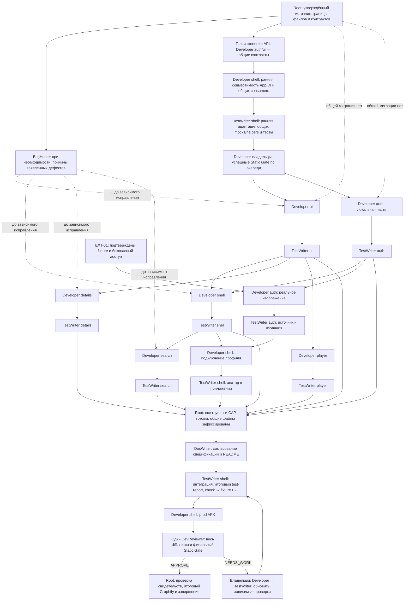

# План: согласовать карточки, поиск, вход и управление TV/mobile по 15 intent
plan_id: ui-intents-polish-2026-10-23
revision: 2
plan_state: PLAN_READY
status: approved
approved_revision: 2
source: mixed
handoff_recommendation: decompose

## Что меняем

Пользователь сталкивается с потерей фокуса, преждевременным открытием меню, прерыванием постера при переходе и растянутой кнопкой панели. Карточки, поиск, сведения об аниме и вход расходятся с согласованным видом. Результат — последовательное управление пультом и касанием, единые карточки и достоверное отображение данных аккаунта.

Входит ровно 15 возможностей. Каждая соответствует одному исходному intent; имена файлов ниже относятся к `docs/intents/`.

- CAP-01 — подпись количества «В списке: N» в секции «Серии» полной карточки; источник `anime-card-episode-label-like-prototype.md`.
- CAP-02 — описание и группы фильтров полной карточки без повторов сведений, с прототипными иконками; источник `anime-description-and-filters-like-prototype.md`.
- CAP-03 — компактные серии без Play на общей карточке UI Kit для главной, жанров и серий; источник `compact-episode-cards-shared-widget.md`.
- CAP-04 — устойчивый фокус в подтверждении выхода из приложения; источник `exit-dialog-loses-focus-to-sidebar.md`.
- CAP-05 — непрерывный прямой Hero постера при загрузке деталей; источник `hero-animation-disappears-during-details-loading.md`.
- CAP-06 — скрытая гостевая кнопка избранного в полной карточке; источник `hide-guest-favorite-login-button.md`.
- CAP-07 — общая закладка с сердечком на TV/mobile и восстановление её показа по подтверждённому избранному; без рейтинга на мобильных карточках; источник `mobile-card-favorite-bookmark.md`.
- CAP-08 — только название без года на мобильных карточках, включая поисковую выдачу; источник `mobile-card-title-without-year.md`.
- CAP-09 — карточки с превью, названием и состояниями в выборе серии плеера; источник `player-episode-picker-image-cards.md`.
- CAP-10 — естественная высота кнопок гостевой и остальных правых панелей; источник `right-menu-buttons-expand-to-full-screen.md`.
- CAP-11 — автоматическая системная клавиатура при новом входе в поиск, корректный Left и прототипное оформление всех состояний поиска; источник `search-system-keyboard-does-not-open.md`.
- CAP-12 — звезда, значение и `/ 10` без обводки в TV-инспекторе выбранного аниме; источник `selected-anime-description-rating-like-prototype.md`.
- CAP-13 — отдельные интро и форма входа с согласованными переходами; источник `separate-intro-and-login-screens.md`.
- CAP-14 — изображение профиля в левом меню текущего аккаунта с инициалами при отсутствии, загрузке или ошибке; источник `sidebar-profile-avatar-with-initials-fallback.md`.
- CAP-15 — Left перемещает между карточками ряда и открывает меню только с первой колонки; источник `tv-left-navigation-opens-menu-too-early.md`.

Не входит: новый дизайн всего приложения, новый API сайта, изменение семантики избранного или просмотренности, постоянный прогресс просмотра, новый движок воспроизведения, обновление SDK, публикация, декомпозиция и реализация в рамках этого запуска. Выбор качества, рейтинги вне названных поверхностей и мобильная сетка серий не перерабатываются. Прототипные данные, фиктивный вход и демонстрационные изображения не становятся production-данными.

Источник и контекст: запрос «Запланируем все наши вот эти новых 15 интентов», уточнения пользователя и неизменяемый снимок `.ai-pipeline/staging/ui-intents-source-snapshot.md`. Файл `.ai-pipeline/staging/ui-intents-source-lock.json` фиксирует SHA256 пятнадцати intent и пяти файлов прототипа: `prototype/index.html`, `prototype/app.js`, `prototype/app.css`, `prototype/responsive.css`, `prototype/DESIGN-HANDOFF.md`. Решения из `.ai-pipeline/staging/planning-session.md` закрывают вопросы снимка. Предыдущий план другого имени не является основанием одобрения этой редакции. Дополнение `.ai-pipeline/staging/ui-intents-orchestration-request.md` поручает планировщику распределить будущую работу между группами агентов и показать граф запуска; revision 2 добавляет эту организацию исполнения, сохраняя продуктовую семантику revision 1.

Авторизация планирования: ожидает подтверждения редакции. Ответы на отдельные вопросы определяют поведение, но не утверждают весь план. Поручение «Сам подумай, как это правильно распределить» разрешает выбор групп и графа ролей, но не самоутверждение плана или запуск реализации. Продолжение запроса — только план.

## Как будет работать

### Основной поток

1. После проверки зеркала и восстановления сессии пользователь без подтверждённого аккаунта видит интро с «Войти» и «Продолжить без входа». На интро нет полей. Действующая восстановленная сессия открывает главную напрямую. Ошибка запуска сохраняет экран ошибки и повтор.
2. «Войти» открывает отдельную форму с начальным фокусом на логине. Гостевой выбор есть только на интро. Вход из меню, мобильного аккаунта, запроса раздела избранного или панели действий сразу открывает форму. Успех ведёт на главную; Back после безопасной отмены возвращает к месту открытия формы (D-01).
3. На главной и в каталогах подтверждённое избранное отмечено общей закладкой. В разделе «Избранное» она скрыта. Мобильный постер показывает название без года и рейтинга. На TV инспектор выбранной карточки показывает допустимый рейтинг звездой, числом и `/ 10` без рамки.
4. На TV Right перемещает вправо, Left возвращает к соседней карточке слева. Только Left с первой карточки текущего ряда переводит фокус в активный пункт меню. Right из меню возвращает доступную цель содержимого. Удержание OK открывает контекстную панель; её кнопки занимают высоту текста и отступов, а не свободную высоту экрана.
5. При выборе поиска из другого раздела поле переходит к редактированию и приложение запрашивает системную IME. Ввод не отправляет HTTP автоматически. Left/Right редактируют текст, Back завершает ввод, затем Left открывает меню на «Поиск». Возврат из деталей и повторный выбор уже активного поиска не открывают IME (D-02).
6. При открытии полной карточки видимый исходный постер сохраняется в полёте Hero, при ожидании деталей и до декодирования замены. Год, жанры, режиссёр и остальные сведения представлены без дублей; пригодные исходные ссылки остаются фильтрами. Гость видит просмотр и содержимое без кнопки входа для избранного.
7. В секции «Серии» показано «В списке: N» по фактически полученному списку. Серии идут по убыванию номера: три колонки на TV, одна строка переменной высоты на телефоне. Карточка использует изображение и общую тёмную градиентную подложку, номер, собственное название и подтверждённую просмотренность. Отдельного Play нет; активируется сама карточка.
8. В плеере выбор серии открывает ту же компактную карточку в правой TV-панели или нижней мобильной панели. Текущая серия видима и получает начальный фокус. Другая серия запускается с нуля; отмена и выбор текущей не перезапускают источник. После закрытия управление возвращается видео.
9. В левом меню аккаунта отображается проверенное изображение профиля либо инициалы. Обновление метаданных не меняет маршрут или доступ. На корне главной подтверждение выхода удерживает фокус на своих действиях до явного действия пользователя; начальный фокус — «Остаться».

### Исключения и развилки

| Условие | Поведение | Связанное решение |
| :--- | :--- | :--- |
| Back во время входа или сбой очистки отменённой попытки | Дождаться подтверждённой очистки; при отказе остаться на форме с «Повторить отмену». Поздний ответ не авторизует аккаунт. После отмены вернуть интро либо прежний гостевой экран и доступный элемент, открывший форму. | D-01 |
| Выход из аккаунта или доказанное истечение сессии | Закрыть прежние аккаунтные маршруты и плеер, показать интро. Гостевой доступ требует нового явного выбора. | D-01 |
| Поиск: нет истории, есть история, идёт запрос, результат пуст или запрос не прошёл проверку | Показать соответствующее отдельное состояние. «Найти» или действие Search запускают запрос; пустой текст и 1–3 символа обрабатываются локально по действующему контракту. | D-02, D-08 |
| Ошибка следующей страницы поиска | Сохранить карточки и явное действие «Повторить загрузку»; не повторять запрос от прокрутки или фокуса. Завершение запроса не перехватывает уже перемещённый фокус. | D-08 |
| Неизвестный статус избранного или ошибка изменения | Не показывать подтверждённое сердце по одному факту входа; сохранить последнее подтверждение, если оно есть в текущем контексте. Существующее действие перечитывания остаётся доступным. | D-03 |
| Гость и список серий пуст, выбранная серия исчезла или запуск недоступен | Не обращаться к скрытой кнопке избранного. Начальная/запасная цель — доступное действие восстановления, затем пригодный фильтр или возврат. Скелетоны не получают фокус. | D-06 |
| У метаданных нет пригодной ссылки или значения | Значение без ссылки остаётся текстом; отсутствующее поле не создаёт пустую плашку. Уникальная категория или иное необязательное сведение сохраняется. | D-07 |
| У серии нет превью или изображение не загрузилось | Сохранить геометрию, подпись и возможность выбора с обычной заглушкой. Отсутствие изображения не означает отсутствие видеопотока. | D-04, D-05 |
| Нет исходного постера при открытии деталей | Использовать существующую заглушку; не запрашивать пустой URI. При наличии исходного изображения ошибка замены сохраняет его. Быстрый Back исключает применение позднего ответа. | D-10 |
| Метаданные аватара или картинка недоступны; пришёл результат прежнего аккаунта/origin | Показать инициалы текущего аккаунта, прежний результат отбросить. Ошибка профиля не завершает сессию и не задерживает каталог. Гость не получает аватар. | D-09 |
| Крупный текст или уменьшение анимаций | Размер текста сохраняется; карточки и кнопки растут и прокручиваются. Декоративное движение отключается без изменения действий, конечного состояния и фокуса. | D-04, D-11 |

## Как устроено решение

| Область/владелец | Ответственность и изменение | Почему | Решение |
| :--- | :--- | :--- | :--- |
| UI Kit | Общая основа `MediaCard`, компактная композиция серии, настраиваемая геометрия, единая подложка/фокус/движение; отдельная общая закладка. Отображает готовые подписи, URI, состояния и callbacks. | Уже используется главной, жанрами и сериями; общий вид не требует общей domain-модели или одинаковой сетки. | D-03, D-04 |
| Catalog, Favorites и Search presentation | Адаптируют карточки под профиль, показывают подтверждённый статус, мобильное название и TV-инспектор. Catalog вместе с оболочкой согласует границу Left; Search владеет вводом, состояниями и восстановлением выдачи. | Смысл данных и доступность действия принадлежат feature; оболочка не знает индекс карточки, UI Kit не знает аккаунт. | D-02, D-03, D-08, D-11 |
| Anime presentation и domain/data | Состав полной карточки, группировка сведений/фильтров, доступные цели фокуса, счётчик и сетка серий. Data сохраняет нормализованные поля и исходные ссылки. | Вычисление состава секций не относится к общему виджету или роутеру. | D-04, D-06, D-07, D-12 |
| Player domain/data/presentation | Неизменяемые метаданные доступных серий в player domain; Data переносит их из публичного DTO AniStar; presentation показывает общую карточку и управляет выбором. | Плееру нужны название и превью, которых сейчас нет в его session-модели; импорт реализации Anime создавал бы неверного владельца. | D-05 |
| Auth domain и владелец состояния | Единое состояние доступа, операции входа/отмены; отдельные необязательные метаданные профиля текущего аккаунта с защитой от старого результата. | Access определяет разрешения и идентичность навигации; картинка профиля не должна пересоздавать маршруты. | D-01, D-09 |
| Infrastructure AniStar и Auth Data | После выполнения условия EXT-01 адаптер извлекает профиль в типизированный DTO, Auth Data переводит его в domain и `Result`/`Failure` через `BaseRepository`. | HTML, источник и правила безопасности принадлежат адаптеру; presentation получает только готовый результат. | D-09 |
| App, Home presentation и UI Kit панелей | App владеет интро/формой и маршрутизацией, подтверждением выхода и передачей профиля оболочке. Оболочка согласует владение фокусом с активным маршрутом; общая панель удерживает его и восстанавливает цель. | Навигация остаётся в App; UI Kit отвечает за контейнер, а состав действий — за вызывающей feature. | D-01, D-10, D-11 |

Расширения сохраняют один корневой `ProviderScope`, существующие Riverpod DI и BLoC по владельцам. Domain остаётся без Flutter, Riverpod, HTML и Dio. Infrastructure не импортирует features/App, внешние потребители используют публичные библиотеки. Новые workspace-пакеты и второй механизм управления состоянием не нужны. Нет `dynamic`, `print`, необоснованных ignore и ручной правки сгенерированных файлов; пароли, cookies, исходный HTML и подписанные URI не попадают в сообщения и логи.

### Поведенчески значимые локальные контракты

- Карточка UI Kit получает нейтральные строковые подписи и полное доступное имя, nullable URI изображения, отдельные признаки текущего выбора и просмотренности, состояние доступности, визуальные метки, ограничения размера и callbacks. Она не получает `AnimeEpisode`, `PlaybackSession`, DTO сайта, репозитории или право менять избранное. Размер выбирает компоновка; масштаб фокуса и подложка общие.
- Метаданные серии в player domain содержат номер `int`, название `String`, превью `Uri?` и подтверждённую просмотренность `bool`. Коллекция неизменяема, серия идентифицируется номером внутри текущего аниме. Текущий номер отделён от просмотренности. Источник потока и его заголовки остаются в существующем playback-контракте; UI Kit получает только превью. Данные доступны также при непосредственном открытии плеера, а не только после посещения деталей.
- Метаданные профиля Auth — отдельное неизменяемое значение с необязательным пригодным `Uri?` изображения для подтверждённого аккаунта. Асинхронный результат связан с ключом аккаунт + origin + generation; отсутствие, ожидание и ошибка отличимы внутри владельца состояния, хотя визуально дают одни инициалы. Repository возвращает типизированный `Result` с `Failure`; UI не превращает ошибку парсинга в успешное отсутствие. `AuthAccess`, ключ router и запись credentials не расширяются ради аватара.
- Запрос профиля запускается после подтверждённого входа/restore в новом аккаунтном контексте, не из `build()` и не от открытия меню. До следующего такого контекста нет фонового опроса или отдельного действия обновления аватара. Старое изображение очищается при выходе, истечении или смене origin; получение картинки не требует повторного login POST. Конкретный способ извлечения и потребность отдельного чтения определяются только подтверждённым источником EXT-01.
- App различает причину открытия формы: интро или существующий гостевой контекст. Отмена возвращает этот контекст после успешной очистки; успешный вход создаёт аккаунтный контекст на главной. Метаданные профиля не участвуют в этом выборе. Скрытие гостевой кнопки деталей не отменяет проверку аккаунта на границе защищённой операции.

### Контракт и подтверждение

| Применимость | Тип контракта | Поведенчески значимая суть | Подтверждение |
| :--- | :--- | :--- | :--- |
| CAP-01, CAP-02, CAP-06 | local_contract | Фактический список серий, необязательные сведения и ссылки; видимость действия определяется доступом, фокус — существующими целями. | project_fact: `docs/specs/12_anime_details.md`, `docs/specs/09_catalog_filters.md`, снимки соответствующих intent; user_acceptance_observation: область счётчика и скрываемой кнопки. |
| CAP-02 | backend_api | Исходные filter paths сохраняются без пересборки/перекодирования; один переход создаёт один каталог, отсутствие ссылки оставляет текст. | project_fact: `docs/specs/09_catalog_filters.md`, `docs/adr/0010-normalized-anistar-contract.md`. Новый сетевой протокол не вводится. |
| CAP-03, CAP-07, CAP-08, CAP-10, CAP-12 | local_contract | Общие визуальные роли, доступные имена, нейтральные состояния карточки, естественная высота кнопок; рейтинг в инспекторе 0–10 с одним знаком и запятой. | project_fact: `lib/packages/ui_kit/README.md`, `docs/specs/11_visual_system.md`, визуальные ориентиры в зафиксированных intent; user_acceptance_observation: новые границы mobile/TV. |
| CAP-04, CAP-15 | local_contract | Содержимое владеет перемещением между карточками, панель владеет модальным фокусом; только явная граница/закрытие передаёт фокус оболочке. | project_fact: `docs/specs/06_tv_interaction.md`, `docs/adr/0008-youtube-tv-interaction-reference.md`; inference: гипотезы причины в снимках, не результат запуска. |
| CAP-05 | local_contract | Hero по ID, исходное изображение доступно до данных деталей и до декодирования замены; старый ответ после Back не меняет экран. | project_fact: `docs/specs/08_motion.md`, intent о Hero. Существующие проверки прогретого кеша не доказывают холодный кеш. |
| CAP-07 | backend_api | Избранное `true`/`false`/`null`; вход сам по себе не подтверждает статус. Только подтверждение сайта обновляет отметку. | project_fact: `docs/specs/02_favorites.md`, intent о закладке; user_acceptance_observation: отсутствие отметки на главной после входа. |
| CAP-09 | local_contract | Player Data сохраняет номер, название, nullable превью и просмотренность в собственном domain-контракте; выбор той же серии не переоткрывает источник. | project_fact: `docs/specs/04_playback.md`, intent о выборе серии; D-05 определяет расширение модели. |
| CAP-11 | platform_plugin_api | Системная IME запрашивается только при новом входе в раздел; режим редактирования отделён от D-pad-навигации. Видимость клавиатуры требует проверки платформы. | project_fact: intent о поиске, действующий путь `TextInput.show`; user_acceptance_observation: триггер открытия и разделение Back/Left. |
| CAP-11 | local_contract | Сохранить явную отправку, ограничение 120 символов, валидацию, состояния, отмену старого запроса и восстановление поиска без повторного HTTP. | project_fact: `docs/specs/13_search.md`; D-08 меняет оформление, не сетевую семантику. |
| CAP-11 | storage | История из восьми запросов разделена по origin и гостю/аккаунту; новые правила IME не меняют ключ и запись истории. | project_fact: `docs/specs/13_search.md`. |
| CAP-13, CAP-14 | local_contract | Доступ и операции Auth отделены от необязательных метаданных профиля; App выбирает маршрут, успешный вход ведёт на главную, отмена — к месту открытия. | project_fact: полные `docs/01_architecture_principles.md`, `docs/02_project_structure.md`, `docs/specs/01_authentication.md`; user_acceptance_observation: ответы пользователя в planning-session. |
| CAP-13, CAP-14 | storage | Существующая encrypted session остаётся привязанной к origin; пароль не сохраняется, аватар не добавляет миграцию credentials. Отмена требует подтверждённой очистки. | project_fact: `docs/specs/01_authentication.md`, `infrastructure/anistar/README.md`. |
| CAP-14 | external_contract | Источник личного изображения, отличие от стандартного аватара и доступность без чувствительных заголовков ещё не подтверждены; применяется условие EXT-01. | user_acceptance_observation: картинка есть в профиле; project_fact: снимок intent фиксирует отсутствие поля и проверенного образца. Endpoint и селектор не установлены. |

После одобрения этот план задаёт явные изменения действующих UI-спецификаций: интро вместо формы после отсутствия/потери сессии; гостевая кнопка только на интро; автоматическая IME при новом входе в поиск; скрытая кнопка избранного деталей у гостя; название без года и рейтинга на mobile; компактная композиция серий и изображения в выборе плеера. При реализации синхронизировать затронутые положения `docs/specs/01_authentication.md`, `02_favorites.md`, `04_playback.md`, `06_tv_interaction.md`, `08_motion.md`, `09_catalog_filters.md`, `10_mobile_interaction.md`, `11_visual_system.md`, `12_anime_details.md`, `13_search.md` и публичное описание UI Kit/нового DTO у владельца. Архитектурная модель ADR-0008 и ADR-0010 сохраняется; старые утверждённые планы остаются неизменяемыми.

## Ключевые решения

| ID | Решение | Почему | Применимость | Проверка/ограничение |
| :--- | :--- | :--- | :--- | :--- |
| D-01 | Интро и форма — отдельные экраны; все внутренние точки входа ведут сразу к форме. Успех ведёт на главную, безопасная отмена — к месту открытия; logout/expiry ведут на интро. | Пользователь явно выбрал «На главную, как сейчас» и разделение экранов; возврат после отмены сохраняет незавершённый гостевой сценарий. | CAP-13 | Интро начинает с «Войти»; форма — с логина. Проверка запуска и очистка отмены не обходятся, аккаунтное действие не повторяется автоматически. |
| D-02 | Автоматически начинать ввод только при входе в поиск из другого раздела в обоих профилях; возврат из карточки и повтор активного раздела сохраняют контекст. | Пользователь выбрал этот триггер, чтобы IME не забирала фокус у возвращённой карточки. | CAP-11 | Back завершает редактирование; Left затем открывает активное меню, а при вводе двигает курсор. Поздний callback не открывает IME на другом маршруте. |
| D-03 | Закладка — общий UI Kit виджет по прототипу, от верхней кромки постера; показывать при подтверждённом `true` вне раздела избранного. Удалить рейтинг только с мобильных карточек и год только из их подписи. | Это заданные пользователем визуальные границы; доступность аккаунта не заменяет подтверждение статуса. | CAP-07, CAP-08 | Сохранить данные, полное название в Semantics, TV-рейтинг карточек и год/рейтинг деталей. Закладка не является отдельным действием. |
| D-04 | Расширять существующий `MediaCard`, использовать общую тёмную градиентную подложку и регулируемую высоту компактной серии; отдельного blur и Play нет. | Пользователь требует тот же эффект, что на главной; существующая общая карточка уже владеет визуальной основой. | CAP-03, CAP-09 | Три TV-колонки и одна мобильная строка сохраняются. Пропорции прототипа — ориентир при обычном тексте; собственное название, просмотренность и системный текст важнее жёсткой высоты. |
| D-05 | Добавить неизменяемые метаданные серий в player domain и маппинг из AniStar DTO; у выбора серий собственная композиция на общей карточке. | Сейчас session теряет название и превью. Передача реализации Anime в Player связала бы независимые feature. | CAP-09 | Качество сохраняет прежнюю строку выбора; текущая серия, просмотренность и фокус независимы. Данные доступны без предварительного открытия деталей. |
| D-06 | Гостевое действие избранного удалить только из полной карточки TV/mobile; пересчитать доступные цели фокуса. | Пользователь просит скрытие без замены, сохраняя вход через меню и панель удержания. | CAP-06 | Пустые серии и отсутствие главного действия оставляют доступные восстановление/фильтр/возврат; защита операции сохраняется. |
| D-07 | Представлять год, жанры и режиссёра один раз: год в основных сведениях, жанры и режиссёр в подписанных группах. При ссылке элемент использует `list-filter`; без ссылки — текст. | Прототип задаёт композицию, а исходные данные содержат дополнительные категории, которые нельзя потерять. | CAP-02 | Сохранить сюжет, «Подробнее», уникальные поля/категории и точные paths. Не угадывать тип по позиции; несопоставленную пригодную метку сохранять отдельно, не удалять. |
| D-08 | Оформлять состояния именно Search по прототипу; рейтинг без рамки применить только к общему TV-инспектору. | Пользователь назвал эти поверхности, а изменение глобальных компонентов затронуло бы другие экраны. | CAP-11, CAP-12 | Поиск включает начало, историю, загрузку, результаты, пустоту, валидацию, ошибку и дозагрузку. Сохраняются данные и существующие действия восстановления. |
| D-09 | Профиль загружается отдельно от Access; инициалы используются при отсутствии, ожидании и ошибке. Обновление — при новом подтверждённом контексте, без постоянного опроса и записи в credentials. | Пользователь подтвердил единый запасной вид; метаданные не должны задерживать вход или пересоздавать router. Ограничение обновления следует существующей изоляции контекста. | CAP-14 | Только текущий аккаунт/origin/generation; прямой URI допустим лишь после EXT-01. Изменения приватного transport возвращаются в планирование. |
| D-10 | Исправление Hero и диалога выбирать после ограниченного воспроизведения, сохраняя существующие механизмы перехода и панели. | В коде уже есть защиты Hero, причина потери фокуса не доказана. Статическая гипотеза не определяет нужное исправление. | CAP-04, CAP-05 | Приёмка задаётся видимым постером и фактическим фокусом. Если подтверждается исправность текущего пути, нужен воспроизводимый регрессионный сценарий, а не дублирующая защита. |
| D-11 | Владение стрелками определяется активным содержимым/панелью; высота кнопок — содержимым, отступами и платформенным минимумом. | Преждевременное меню и растянутая гостевая кнопка указывают на конфликт композиции; глобальная задержка ввода или фиксированная высота его не решают. | CAP-04, CAP-10, CAP-15 | Проверить полную оболочку, все типы правых панелей и mobile-панель общего компонента. Дополнительные исправления ограничить тем же подтверждённым дефектом. |
| D-12 | «В списке: N» — общий текст секции серий TV/mobile, где N равно длине фактического списка, включая ноль. | Пользователь подтвердил секцию и смысл количества; одна подпись сохраняет общий смысл данных при разных компоновках. | CAP-01 | Не подменять максимальным номером, плановым количеством из `seriesInfo` или подписью отдельной серии. |
| D-13 | Организовать исполнение шестью группами Developer → TestWriter с динамическим запуском готовых узлов, максимум тремя активными сабагентами суммарно и одним итоговым DevReviewer. Общие файлы имеют одного владельца, команды и итоговые проверки выполняются последовательно. | Пользователь поручил планировщику выбрать группировку. Границы UI Kit, Auth, оболочки, Anime, Player и Search позволяют разделить запись; общий итог проверяет их взаимодействие. | global | Граф и правила ниже относятся к ролям, не к тикетам. Локальный PASS не заменяет итоговые тесты, ревью и условие EXT-01. |

## Неизвестное и границы

- EXT-01 — владелец внешнего источника: сайт AniStar; владелец проверки со стороны приложения: ответственный за адаптер AniStar. Не подтверждены разметка личного аватара, исходный URI, отличие личной картинки от стандартной и необходимость cookies/Referer. Обработка: до реализации извлечения и доставки изображения получить проверяемый очищенный образец из разрешённого источника, зафиксировать происхождение и условия доступа, подтвердить варианты «личная картинка», «нет личной картинки» и ошибку. Если готового безопасного fixture нет, запросить отдельный явный объём живой проверки аккаунта; этот план его не разрешает. Не выводить HTML/credentials в отчёт. Допустимость прямой загрузки без чувствительных заголовков должна быть подтверждена. Если нужны cookies/headers либо иной чувствительный transport, вернуть конкретный факт в планирование до реализации этого пути; не передавать credentials постороннему хосту изображения. До получения данных CAP-14 не считать реализованной целиком; остальные возможности продолжаются независимо.
- Исследование ограничено воспроизведением заявленных симптомов CAP-04, CAP-05, CAP-07, CAP-10, CAP-11 и CAP-15 в соответствующей композиции. Начать с зафиксированного пользователем TV-пути, проверить затронутую общую поверхность и второй профиль там, где он использует тот же компонент. Результат — наблюдаемая последовательность, отличие ожидаемого состояния и подтверждённая причина либо точные условия, при которых симптом не воспроизведён. Произвольный рефакторинг соседних областей в этот объём не входит. Новое поведение или новая внешняя зависимость возвращаются в планирование.
- Риски: состояние данных может меняться во время перехода или панели; старые callbacks не должны забирать фокус, открывать IME либо публиковать чужие данные. Общая карточка и панель имеют несколько потребителей — проверять их вместе с изменением. Метаданные группируются по подтверждённому смыслу, а не по выдуманным URL. При недостаточной классификации сохранять уникальную метку.
- Визуальное сравнение зависит от профиля, viewport, DPR, шрифтов и масштаба текста. CSS px не принимаются автоматически за Flutter logical pixels. Native TV 960×540 сравнивается с TV-образцом, хотя HTML на такой ширине переключает оболочку. Прототип не отменяет согласованную одноколоночную мобильную компоновку серий и состояние реальных ошибок.

## Готовность и проверка

### Приёмка разработчиком и готовность

- Семантическая карта готова к рассмотрению. Ни один тест, эмулятор или сборка этим планированием не запускались; статические свидетельства не являются результатом воспроизведения. Ниже заданы будущие детерминированные проверки.

| Возможность | Наблюдаемый критерий приёмки на контролируемых данных |
| :--- | :--- |
| CAP-01 | Для списка номеров 1, 3, 8 текст равен «В списке: 3»; для пустого — «В списке: 0». Обновление списка меняет число. Подписи «Серия N» не изменены, отдельной цели фокуса у счётчика нет. |
| CAP-02 | Год/жанр/режиссёр представлены по одному разу; уникальные категории и необязательные поля сохранены. Нет пустых плашек. Каждая интерактивная метка имеет `list-filter` и открывает исходный path ровно один раз; без ссылки значение остаётся текстом. Возврат восстанавливает исходную метку; раскрытие сюжета сохраняется. |
| CAP-03 | Главная, жанры и серии используют общую визуальную основу. В серии нет Play, номер и собственное название доступны, просмотренность отдельна от фокуса. Три TV-колонки/одна мобильная строка, рост при крупном тексте, одинаковая геометрия загрузки/готовности и однократная активация сохраняются. |
| CAP-04 | Через полную цепочку содержимое → меню главной → подтверждение начальный фокус на «Остаться». Без новых команд он остаётся в открытом диалоге после всех отложенных callbacks и более секунды. Стрелки не управляют фоном; отмена возвращает фокус, только подтверждение вызывает выход. Повторы/отпускание открывшей команды не выполняют новое действие. |
| CAP-05 | При задержанном/раннем ответе деталей исходный декодированный постер не пропадает при смене состояний. Другой URI заменяет его только после декодирования; ошибка сохраняет исходный. Обратный переход и быстрый Back с поздним ответом корректны; отсутствие исходника даёт обычную заглушку. Проверки включают контролируемую задержку первого декодирования, а не только заранее заполненный кеш. |
| CAP-06 | В гостевых TV/mobile деталях нет кнопки входа для избранного, замены, пустого места под неё и недоступной цели фокуса. При пустых сериях доступен повтор и возврат. Аккаунтные состояния действия и гостевой вход из панели удержания/меню сохранены. |
| CAP-07 | Для `true` в текущем аккаунте на главной/в каталоге видна закладка; для `false`, `null`, гостя и раздела избранного её нет. Переход вход → загрузка подтверждённого статуса отображает отметку в обоих профилях; выход и смена origin исключают прежнюю. Ошибка мутации не даёт ложного успеха. Mobile не показывает рейтинг; TV сохраняет его. |
| CAP-08 | Главная, избранное, каталог фильтра и результаты поиска mobile показывают только название, максимум в двух визуальных строках с полным доступным именем. Год остаётся в domain и деталях; TV-подпись не меняется от мобильного правила. |
| CAP-09 | Player repository сохраняет метаданные, включая nullable превью, в неизменяемой модели. Панель сразу раскрывает текущую серию среди длинного списка. Текущая/просмотренная/сфокусированная состояния различимы. Ошибка изображения оставляет выбор. Отмена и текущая серия не переоткрывают поток, другая открывается один раз с нуля; после закрытия фокус у видео. Качество сохраняет прежнее поведение. |
| CAP-10 | Гостевая кнопка после удержания находится внутри панели, имеет высоту содержимого с минимумом TV 56/touch 48 и не заполняет оставшуюся область по высоте. Длинная подпись растёт без обрезания и overflow. Те же свойства проверены для действий избранного, сортировки, серий/качества и подтверждений в доступных состояниях. |
| CAP-11 | Только переход из другого раздела включает редактирование и запрос IME. Возврат из деталей сохраняет запрос, выдачу, прокрутку и карточку без HTTP и IME, повтор активного раздела не отнимает фокус. Left/Right при вводе не открывают меню; Back → Left фокусирует «Поиск» в реальной оболочке, Right возвращает поле. Все состояния доступны через fakes; поиск сохраняет отмену, валидацию, историю и явный повтор пагинации. |
| CAP-12 | Общий TV-инспектор главной, избранного, каталога фильтра и поиска показывает звезду, одно десятичное значение с запятой и `/ 10` без рамки/плашки. `null`, нечисловые и значения вне 0–10 скрыты. Semantics сообщает «Рейтинг … из 10»; рейтинг не получает фокус. |
| CAP-13 | Ветви восстановления, отсутствия сессии и ошибки, интро → гость/форма, все внутренние точки входа, успешный вход → главная, Back → место открытия, выход/истечение → интро покрыты. Отмена во время запроса и отказ очистки оставляют явный повтор; поздний ответ не авторизует. Неверный пароль очищает только пароль; транспортный или серверный отказ сохраняет оба поля. |
| CAP-14 | На проверенных fixtures после условия EXT-01 цепочка данных возвращает изображение текущего аккаунта либо корректное отсутствие/ошибку. UI показывает инициалы при отсутствии/ожидании/ошибке и изображение при успехе; гость без аватара. Поздний ответ прежнего аккаунта/origin отбрасывается, ошибка не меняет Access, router или вход. Общий компонент сохраняет мобильный блок аккаунта, его имя и действия. |
| CAP-15 | В составе настоящей оболочки Right → Right → Left → Left возвращает фокус по каждой карточке при закрытом меню; следующий Left открывает активный пункт меню. Проверяются первая и нижняя строки, repeat и правая граница. Избранное, фильтрованный каталог и серии проверяются на тот же симптом; причина не переносится на них без свидетельства. |

- Визуальные ориентиры проверяются на зафиксированном прототипе: закладка от верхней кромки с исходной формой `36×48`, сердцем `20` и правым отступом `16` в CSS-образце; мобильное название Manrope 600 с двумя строками; компактная серия по горизонтальному образцу `219:92` с общей подложкой. Эти исходные параметры не отменяют адаптацию текста и размеров.
- Для Search отдельно сопоставить начальную лупу без прежнего круга/обрамлённой поверхности, «Что будем смотреть?», историю, форму с иконкой и текстом «Найти», «Ищем аниме…» со скелетоном, «Найдено: N», закрепление TV-инспектора над прокручиваемой выдачей и все ветви ошибок/дозагрузки. Сравнивать геометрию состояний, а не только наличие строк.
- Будущий объём обновления golden после утверждения плана и запуска реализации: затронутые карточки TV/mobile, инспектор, полная карточка и серии, выбор серии плеера, все перечисленные состояния поиска, интро/форма, гостевая и затронутые общие панели, блок аккаунта с изображением/инициалами. Просмотреть PNG и diff, затем выполнить точное повторное сравнение. Этот черновик ещё не разрешает обновление эталонов.
- Будущие обязательные проверки выполняются последовательно: `fvm dart run melos run check` → `fvm dart run melos run test:e2e` → `fvm dart run melos run build:android:prod:apk`. Widget/contract проверки дополняются запрошенной Android fixture E2E-регрессией CAP-15 с фактическим фокусом и состоянием меню. Изменение typed routes требует штатной генерации; Flutter/Gradle/codegen не выполняются параллельно.

| Возможность | Текущая готовность | Условие старта |
| :--- | :--- | :--- |
| CAP-01, CAP-02, CAP-03, CAP-04, CAP-05, CAP-06, CAP-07, CAP-08, CAP-09, CAP-10, CAP-11, CAP-12, CAP-13, CAP-15 | Семантически готовы; исследования дефектов имеют заданные границы и результат. | Утверждение этой редакции и отдельный выбор реализации либо декомпозиции. |
| CAP-14 | Отображение, запасной вид и локальные контракты определены; получение и доставка реального изображения ожидают подтверждения источника. | Помимо общего разрешения, проверенный безопасный fixture и подтверждённый способ доступа по EXT-01. При потребности чувствительных заголовков — новая согласованная редакция решения. До этого допустима подготовка независимой части, но не заявление о завершённом аватаре. |

### Проверки QA

- На TV 960×540 и 1280×720, телефоне в портретной и короткой альбомной ориентации проверить затронутые поверхности при тексте 100%/200% и уменьшении анимаций. Для визуального сравнения зафиксировать профиль, CSS/native viewport, DPR и масштаб. Осмотреть читаемость, форму закладки, компактность серий, подписи, метки, иконки, края фокуса и отсутствие overflow.
- Через Android fixture выполнить полный пользовательский путь с новой схемой интро/формы, гостевым доступом, входом, restore, отменой, logout и expiry; проверить возврат к гостевому поиску/панели и главную после успеха. Данные другого аккаунта или зеркала не появляются даже при задержанных ответах.
- Для поиска записать AVD/API, реальный профиль, IME, hardware keyboard и настройку экранной клавиатуры. Проверить фактически видимую системную IME и ввод при входе из другого раздела, её отсутствие при возврате из карточки, Back → Left → меню и курсор Left/Right во время редактирования. Вызов `TextInput.show` и тестовый `enterText` сами этого не доказывают.
- Для CAP-15 пройти соседние карточки через `Extended Controls → Directional Pad`, затем на физическом пульте при доступном устройстве. Проверить нижний ряд и удержание, меню/возврат, серию и фильтрованный каталог. Синтетические события не заменяют этот путь ввода.
- Для подтверждения выхода различить закрытие самой панели и уход фокуса при остающейся панели. Проверить одиночный Back, быстрое открытие после смены раздела, остаточные события кнопки и отсутствие самопроизвольного изменения без ввода. Сохранить действия «Остаться»/«Выйти» и штатное Android-завершение.
- Для Hero начать с TV-эмулятора, где замечен дефект: записать ревизию сборки и кадры первого открытия при холодном кеше, повторного открытия, раннего/позднего ответа, смены URI, ошибки изображения и Back. Затем проверить mobile и reduced motion. Наличие `RawImage` в widget-дереве не заменяет наблюдение видимых кадров.
- В native fixture-плеере проверить текущую далёкую серию, прокрутку карточек, отсутствие команд фоновому видео, отмену и смену серии, возвращение к видео, качество и lifecycle. Для всех панелей проверить длинные подписи и доступность действий касанием/пультом.
- Живой профиль, сайт и CDN проверяются только в отдельно разрешённом объёме. Очищенные fixtures подтверждают заданный контракт, но не доступность текущего сайта. Отчёт реализации отдельно указывает свежие результаты, команды/exit codes, проверенную ревизию, конфигурацию устройств и пропуски; отсутствие физического TV, live-проверки или iOS E2E остаётся явной границей вывода.

## Передача дальше

- Рекомендация: `decompose`.
- Почему: пятнадцать возможностей затрагивают общие карточки, фокус оболочки, Auth/App и данные Player; отдельное нарезание поможет сохранить проверяемое покрытие каждого исходного intent и условие аватара.
- Что получает следующий этап: утверждённую редакцию с CAP-01–CAP-15, поведением, владельцами, типизированными границами, решениями, условиями EXT-01 и критериями проверки. Дополнительно получает граф ролей и правила D-13 ниже. Текущие исходники и точные границы файлов определяются на этапе исполнения без изменения семантики; при отдельной декомпозиции этот граф сохраняет ограничения, но не задаёт нарезку тикетов.
- Предупреждение/условия: текущая редакция — draft. Утверждение и сохранение неизменяемой копии в `docs/plans/` принадлежат оркестратору; условная часть CAP-14 не становится готовой от одного утверждения. Прямое исполнение после отдельного выбора возможно, но требует сохранять покрытие всего объёма.
- Продолжение: только план.
- Рекомендация сама по себе не является авторизацией.

### Группы агентов и ответственность

Это схема будущего исполнения после утверждения плана и выбора продолжения. Она применима и к прямому исполнению, и к исполнению после отдельной декомпозиции. Названия групп — области ответственности агентов, а не номера задач. Шесть групп дают несколько Developer и TestWriter за весь запуск; число одновременно активных сабагентов любых ролей не превышает трёх. Root в этот лимит не входит и управляет зависимостями, владением файлами и очередью команд.

Каждой группе назначается собственная пара Developer → TestWriter. В основном проходе Developer пишет production и запускает свой Static Gate; TestWriter затем пишет и непосредственно выполняет тесты по зафиксированному поведению. Отдельный ранний контрактный проход ниже разрешает владельцам общих consumers и mocks подготовить совместимость до основного старта их группы. Работа пары завершается проверенным отчётом, а не сообщением «готово». Распределение частичных CAP ниже обозначает разные стороны одного требования, не уменьшение его приёмки.

| Группа и ключ отчётов | Developer: исключительная область записи | TestWriter: область проверки и записи | Условие основного старта |
| :--- | :--- | :--- | :--- |
| Общие компоненты — `ui` | UI Kit: общая компактная карточка CAP-03, закладка и параметры подписи CAP-07/CAP-08, общие контейнеры/кнопки CAP-10, примитив изображения/инициалов CAP-14. Общие focus/Hero-компоненты меняются здесь только по подтверждённой причине CAP-04/CAP-05. | Тесты UI Kit, геометрия, состояния, Semantics, текст 200%, reduced motion; общие регрессии компонента. | Зафиксированы публичные параметры и совместимость с текущими потребителями; при необходимости завершён ранний контрактный проход. Для исправления дефекта получена ограниченная диагностика. |
| Вход и профиль — `auth` | Auth domain/data/presentation: интро/форма и переходы состояния CAP-13, отдельные метаданные CAP-14. Единственный владелец затрагиваемых общих контрактов/экспортов AniStar и адаптера профиля; извлечение и доставка изображения — только после EXT-01. | Auth и профиль AniStar: отмена, ошибки, изоляция account/origin/generation, отсутствие/ошибка изображения; собственные fixtures профиля. | Локальная часть независима от `ui`; несовместимые общие API проходят раннюю миграцию до основного прохода. Визуальное подключение использует проверенный компонент `ui`. Внешняя часть ждёт EXT-01. |
| Оболочка и каталоги — `shell` | App, Home, Catalog, Favorites и общая feature-композиция инспектора: CAP-04, CAP-07, CAP-08, CAP-10, CAP-12, CAP-15. Единственный владелец всех затрагиваемых App router/DI/typed routes, соединений CAP-13/CAP-14 и оболочечного контракта CAP-11. | Тесты оболочки, каталогов и избранного; сквозные переходы фокуса, подтверждение выхода, аккаунтные состояния. Единственный владелец общих test mocks/helpers и общих Android fixture/E2E-файлов. | Основной проход: Test Gate `ui` и локальной части `auth` — PASS; причина дефекта подтверждена. Ранние ограниченные проходы Developer/TestWriter для App/DI и общих mocks разрешены сразу после фиксации мигрируемого контракта и не ждут PASS `auth`. |
| Полная карточка — `details` | Anime: CAP-01, CAP-02, CAP-06, подключение CAP-03 и feature-часть CAP-05. Правки общих Hero-компонентов и App передаются их владельцам. | Anime: счётчик, метаданные/фильтры, гостевой фокус, серии, холодное декодирование и возврат; собственные fakes. | Test Gate `ui` — PASS; для Hero есть результаты диагностики. |
| Выбор серии — `player` | Player domain/data/presentation: CAP-09 и подключение общей карточки/панели CAP-03/CAP-10. Читает публичный AniStar DTO; изменение его общего контракта выполняет `auth` как назначенный владелец infrastructure, без переноса логики Player в Auth. | Player: маппинг метаданных, текущая/просмотренная серия, отсутствие изображения, отмена, смена серии и lifecycle. | Test Gate `ui` — PASS; используемый публичный DTO доступен. Посещение деталей не является зависимостью. |
| Поиск — `search` | Search: CAP-11 и потребление общих правил CAP-07/CAP-08/CAP-12. App/Home/общий инспектор меняет `shell`, UI Kit — `ui`. | Search: состояния, IME-триггеры, редактирование/навигация, возврат из деталей, сохранение запроса и выдачи; собственные fakes. | Test Gate `shell` — PASS, включая оболочечный контракт входа/возврата поиска; Test Gate `ui` актуален. |

Распределение файлов уточняет root перед первым запуском по текущему checkout: один файл целиком принадлежит одному писателю, даже если содержит несколько областей. Общий файл не делится по диапазонам строк. Карта записи фиксирует production, generated, tests, mocks, fixtures и отчёты отдельно. Пути выше задают архитектурное владение, а не разрешение переписать целый каталог. Каждая роль получает только минимальный фактический список файлов своей области, source lock и конкретные документы из контракта.

После готовности групп один DocWriter синхронизирует перечисленные выше спецификации и публичные README с утверждённым поведением и реальной реализацией. Это единственный писатель документации; Developer не подменяет его, TestWriter не правит production. Утверждённые планы и исходные intent остаются неизменными. DocWriter входит в тот же лимит трёх активных сабагентов.

### Граф запуска

Стрелка означает зависимость готовности, а не обязательную отдельную волну. Основной узел TestWriter включает собственный прямой запуск тестов и проверенный PASS; основной узел Developer включает прямой Static Gate. Верхняя цепочка контрактной миграции — ограниченные проходы тех же владельцев до основных узлов; без изменения общего API она пропускается целиком. На схеме показана отдельная поздняя ветвь аватара: если EXT-01 подтверждена сразу, соответствующие проходы совмещаются с основными проходами `auth` и `shell`.

BugHunter нужен только там, где ограниченное чтение не установило причину; один агент может исследовать несколько связанных симптомов из уже заданного объёма. Его `analysis.md` не имеет параллельного писателя. Исследуемые файлы и зависимости сохраняются неизменными на время воспроизведения; независимая работа продолжается. Пунктирная связь запрещает соответствующее исправление до доказательства причины, но не задерживает независимую новую композицию карточки или экран входа. Блокер воспроизведения приостанавливает зависимый узел, не все независимые группы.

Root запускает любой готовый независимый узел при свободном слоте. Например, после PASS `ui` можно начать `details` и `player`, пока `auth` завершает свои проверки. После готовности `auth` свободный слот получает `shell`; после его PASS — `search`. Если слот нужен TestWriter, исследованию или исправлению, новый Developer ждёт. Отдельные Developer/TestWriter разных групп не закрепляются навечно за тремя слотами. Живой заблокированный или ожидающий команды агент тоже занимает слот, пока не вернул управление; недоступный четвёртый слот не создаётся через вложенного агента.

### Общие контракты, команды и отчёты

Перед запуском зависимого писателя root фиксирует проверенную версию контракта: параметры `MediaCard`/панели, публичные метаданные серии и профиля, callbacks оболочки, разделение Access и профиля. Предпочтителен совместимый переход с текущими потребителями. Если изменение публичного API затрагивает чужой consumer или общий FakeAnistarClient, применяется ранний контрактный проход, показанный над основными группами:

1. Root резервирует все файлы миграции и фиксирует техническую форму API внутри утверждённой семантики. Developer `auth` меняет общие AniStar/Auth-контракты, Developer `ui` — UI Kit; требуемые изменения этих двух владельцев выполняются последовательно. Для изменений метаданных Player инициатором служит `player`, но общие AniStar exports по-прежнему пишет `auth`.
2. Developer `shell` выполняет только необходимые адаптации App/DI и общих production-consumers. Этот ранний проход не ждёт Test Gate `auth` или `ui`; основная реализация оболочки ещё не стартует. Другой feature-consumer при необходимости адаптирует его собственный Developer под тем же резервированием.
3. TestWriter `shell` по уже записанному API адаптирует общие mocks/helpers, включая FakeAnistarClient, и непосредственно запускает связанные проверки. Если нужны собственные тестовые двойники другой группы, их последовательно адаптирует её TestWriter. Ожидания поведения не меняются. Это ограниченный тестовый проход совместимости, а не PASS всей группы `shell`.
4. Все Developer, чьи production-файлы изменились, непосредственно доводят свои Static Gate до успешного результата в общей очереди; затем каждая группа проходит обычный Developer → TestWriter. Промежуточный preflight может обнаружить ещё не адаптированный тестовый double: это явный незавершённый результат, который root направляет TestWriter, а не разрешение Developer править тесты. Такой checkpoint не является `IMPLEMENTED`; необходимые повторы учитываются по обычным лимитам. Ни один зависимый основной узел не стартует по незавершённому gate.

Так ранняя совместимость общих helpers не зависит от завершения Auth, а основной `shell` по-прежнему получает проверенную локальную часть Auth. Новые интерфейсы не придумываются ради теста: источник поведения — утверждённый план, техническая форма — зафиксированный контракт и фактический production API. Этот же последовательный протокол применяется при позднем подтверждении EXT-01 и при изменении общего API в Fix Loop; он не разрешает извлечение профиля до условия EXT-01.

Нужная правка вне собственной области возвращается root как запрос владельцу с причиной и затронутым контрактом. Root сначала завершает текущую запись/проверку зависимых файлов, затем выдаёт единственному владельцу ограниченный проход. Передача владения возможна только после подтверждённого завершения прежнего писателя и обновления карты. Это относится и к общим mocks/helpers, fixture-сценариям, экспортам, generated-файлам и документации. Перенос групп между путями не меняет слой ответственности: инфраструктурный DTO остаётся в AniStar, player domain — в Player, DI — в App.

Для будущего исполнения использовать один `run_id`, один `source_hash` утверждённой редакции и один родительский `.ai-pipeline/state/pipeline.md`. Параллельные группы не создают шесть конкурирующих корневых pipeline. Раздельные пути отчётов — проектное решение этой схемы по D-13 для предотвращения коллизий. Пользователь запросил граф и короткую коммуникацию; конкретные пути выбрал планировщик. Это ограниченная адаптация путей стандартного последовательного процесса; формат, роль писателя и проверки свидетельств сохраняются:

| Артефакт будущего исполнения | Единственный писатель | Назначение |
| :--- | :--- | :--- |
| `.ai-pipeline/state/pipeline.md`, `.ai-pipeline/state/execution-brief.md` | Root | Источник, карта файлов и контрактов, зависимости групп, активные роли, очередь команд, счётчики и ссылки на свидетельства. |
| `.ai-pipeline/state/streams/<group>/developer-report.md` | Developer соответствующей группы | Отчёт разрешённого production-прохода: source lock, changed files, Static Gate с cwd/командами/exit codes, ограничения. Это объявленный для этого запуска тип отчёта Developer, не дополнительный gate. |
| `.ai-pipeline/state/streams/<group>/test-report.md` | TestWriter соответствующей группы | Стандартный test-report для точной локальной области с её `tested_files`, командами, покрытием и результатом. `<group>` — один из ключей `ui`, `auth`, `shell`, `details`, `player`, `search`. |
| `.ai-pipeline/state/analysis.md` | Единственный BugHunter | Ограниченная диагностика; готовые результаты сохраняются при следующих проходах того же агента. |
| `.ai-pipeline/state/test-report.md` | TestWriter `shell` в итоговом интеграционном проходе | Полный изменённый scope запуска; свежие прямые тесты, `check` и fixture `test:e2e`. Не механическая сумма локальных PASS. |
| `.ai-pipeline/state/review.md`, затем `.ai-pipeline/state/re-review.md` | Единственный DevReviewer | Итоговое интегрированное ревью и проверка исправлений с устойчивыми `REV-*`. |
| Назначенные спецификации и README | DocWriter | Согласованная документация; `DOCS_UPDATED` и конкретный список проверенных документов возвращаются root. |

Root заранее регистрирует временные артефакты в `owned_artifacts`, передаёт каждой роли точный разрешённый путь и отмечает текущий проход. Отчёты начинают с `run_id` и `source_hash`; у локальных отчётов дополнительно однозначно указаны группа и область. Root сохраняет контрольные свидетельства завершённых проходов и их статусы в родительском состоянии, не переписывая чужой вердикт. Только итоговые канонические отчёты открывают общие Test Gate и Review Gate. Один и тот же файл отчёта никогда не имеет двух активных писателей.

Для всех Flutter/Gradle/codegen, тестов и проверок действует одна очередь команд под управлением root. Два агента могут независимо читать или писать разрешённые непересекающиеся файлы, но команды из этой очереди выполняются по одной. Для workspace Analyze/DCM/Format, генерации и итоговых gates дополнительно замораживаются все читаемые ими исходники: никто не пишет production/tests/docs во время такого снимка. Для локального теста фиксируются его файлы и транзитивные зависимости; при невозможности надёжно отделить их используется общая пауза записи. Пауза относится к записи и командам, не к рассуждению или чтению.

- Каждый Developer непосредственно запускает из корня `fvm dart run melos run analyze` → `fvm dart run melos run dcm` → `fvm dart run melos run format:check` после своего production-прохода. Root проверяет свидетельства и маршрутизирует ошибки; сам эти команды не выполняет. Эти команды охватывают workspace, `--scope` их не сужает.
- TestWriter непосредственно выполняет назначенные тесты, в том числе неизменённые регрессии. `tested_files` ровно соответствует changed scope его отчёта; значения вычисляются `git hash-object` из корня после записи и повторно сверяются после команд, удалённые файлы имеют `DELETED`. Зависимые общие файлы дополнительно фиксируются в контрольном снимке root: неизменный локальный тест не делает его PASS актуальным после изменения общего компонента.
- Codegen выполняет назначенный Developer в единственном окне генерации. Владелец App `shell` координирует typed routes; все затрагиваемые generated outputs заранее резервируются, другие писатели ждут. Ручные правки generated запрещены. Форматирование также ограничивается своей областью либо резервируется как общая операция.
- Любая поздняя правка общего UI, Auth/App-контракта, DTO, mocks или fixture аннулирует прежние свидетельства зависящих групп. Root помечает их устаревшими, снова направляет production-изменения на Static Gate и тесты соответствующим TestWriter. При неизвестной области влияния перепроверяются все группы. После изменения окончательного diff итоговые тесты, APK и ревью получают свежие свидетельства; локальные старые PASS не переносятся автоматически.

### Итоговая проверка и цикл исправлений

После всех production/test/documentation-записей TestWriter `shell` проводит интеграционный проход по всем CAP, включая совместное действие Auth, поиска, оболочки, деталей и плеера. Он доводит общие Android fixture-сценарии, выполняет прямые проверки и последовательно запускает `fvm dart run melos run check` → `fvm dart run melos run test:e2e`. Затем Developer `shell` непосредственно запускает `fvm dart run melos run build:android:prod:apk`. Root сохраняет текущие команды, exit codes и хеши; недоступный инструмент или подпись APK остаются явным блокером соответствующего gate, а не успешной заменой другой командой. Golden Gate и отдельное разрешение live-проверок сохраняются.

Только после PASS тестов и завершения записей запускается один канонический DevReviewer. Он проверяет весь diff и все 15 CAP в одном проходе: соответствие источнику, корректность, архитектуру/объём и достаточность тестов. Локальные отчёты служат детализацией, а обязательный вход — актуальный общий `test-report.md` с полным changed scope. DevReviewer сам выполняет финальные workspace Analyze/DCM/Format Check в общей очереди, не применяет форматирование и не правит исходники. Дополнительные параллельные ревьюеры для этого графа не нужны: единый владелец вердикта видит межгрупповые ошибки и не создаёт конкурирующие `review.md`.

При `NEEDS_WORK` root распределяет все `REV-*` по владельцам файлов. Production исправляет соответствующий Developer, тесты — соответствующий TestWriter; смешанный дефект проходит их последовательно. После production повторяется Static Gate, после любого существенного изменения — зависимые тесты и общий Test Gate. Итоговая последовательность `check` → fixture E2E → APK обновляется для нового diff; тот же DevReviewer пишет `re-review.md`, отмечая каждый исходный `REV-*` как `FIXED`, `NOT_FIXED` или `REGRESSION`. Новый значимый дефект получает следующий ID. Счётчики ведёт root по возвращённым результатам: до двух Static Gate retries и двух test-fix итераций; для всего объёма как `feature` — до двух review-fix итераций, для отдельно выбранного `task/refactor` — одна. Результат восстановления агента не расходует эти счётчики. Семантический пробел проходит Material Semantic Gap Gate и возвращается в планирование, а не исправляется произвольной сменой ожиданий теста.

`APPROVE` требует свежего PASS всех обязательных статических проверок и тестов, отсутствия значимых замечаний и совпадения проверенных байтов с итоговым diff. Root отдельно проверяет APK и полноту приёмки. После завершения всех писателей и исправлений root выполняет предусмотренное проектом итоговое обновление Graphify и завершение pipeline; отсутствие доступного Graphify отражается отдельно по действующему контракту. Commit, push и публикация не следуют из этого графа.

### Аватар и незавершённая внешняя зависимость

Ожидание EXT-01 не удерживает слот: `auth` возвращает полный отчёт о готовой локальной части и точном условии продолжения. `ui`, `shell` и остальные группы продолжают независимую работу с корректными инициалами и локальными тестовыми данными. Такая готовность не подтверждает реальный профиль и не превращает CAP-14 в завершённую возможность.

После подтверждения очищенного источника и безопасного способа доставки root продолжает `auth` для адаптера/маппинга и его TestWriter, затем `shell` для подключения и его TestWriter. При изменении общего контракта повторяются зависимые проверки. Если нужен чувствительный transport, действует D-09 и возврат в планирование до зависимой реализации. Если EXT-01 остаётся открытой, можно получить частные результаты остальных групп, но узел полной готовности на графе не пройден: нет окончательного `APPROVE` всего плана и заявления «все 15 реализованы». Частичное завершение с исключением CAP-14 требует отдельного изменения согласованного scope; оно не вводится исполнителями автоматически.

### Runtime и коммуникация

Используются канонические роли из `.codex/agents/`: Developer и TestWriter — `gpt-5.6-terra`, `high`; DevReviewer и при необходимости BugHunter — `gpt-6.1-sol`, `high`; DocWriter — `gpt-6-luna`, `high`. Перед будущим dispatch root проверяет реальную доступность `agent_type` и wrapper; при допустимом fallback передаёт явные model/effort по `.agents/adapters/codex.md`. Недоступная требуемая роль или модель не заменяется молча родительской. Возможности runtime не расширяют право записи роли. Каждая новая активная роль, в том числе исследователь, DocWriter, повторный проход или ревьюер, занимает один из трёх слотов. Вложенный запуск новых агентов этим графом не разрешён.

Сообщения root и между агентами короткие и только по необходимости: завершённый handoff, конкретный блокер, изменение общего контракта или вопрос пользователя. Сообщение о handoff называет группу, Done Signal, путь отчёта и следующую зависимость; подробные файлы, команды и доказательства остаются в полном отчёте. Запрос соседу не передаёт владение файлом без решения root. Нет обязательных heartbeat и пересказа внутренних логов. Тишина, ожидание команды и истечение времени не означают сбой; восстановление допускается только после явной ошибки runtime, блокирующего Done Signal или невалидного возвращённого handoff по общему checkpoint-контракту.
