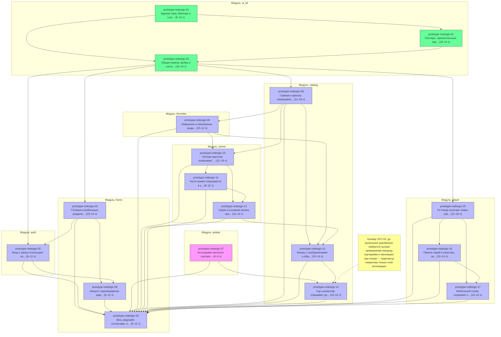

# Эпик: полный редизайн AniStar TV по прототипу

- **Источник плана:** [prototype-app-redesign-2026-10-22 revision 3](../plans/prototype-app-redesign-2026-10-22.md)
- **Ожидаемый результат:** единый дизайн TV/mobile, полноценный общий UI Kit и согласованные возможности прототипа при сохранении реальных сетевых и нативных контрактов.
- **Оценка:** 170–240 ч суммарной работы с детерминированными тестами; это не календарный срок работы агентов. Физические проверки QA учитываются отдельно.
- **Состав:** 18 задач, CAP-01–CAP-11; три направления разработки и отдельные роли TestWriter, DevReviewer и DocWriter.
- **Проверка декомпозиции:** граф зависимостей — PASS; независимое ревью — APPROVE после исправлений и контрольной перепроверки.

## Критерии готовности эпика

- [ ] Выполнены все обязательные задачи и CAP-01–CAP-11 утверждённой revision 3; отложенные части закрыты, временных заглушек и демонстрационных данных в production нет.
- [ ] Общие компоненты UI Kit используются реальными потребителями; сохранены единый ввод, фокус, доступность, загрузка изображений и различия TV/mobile.
- [ ] Применены карта визуальных источников, реальные данные сайта, согласованные правила входа, избранного, серий, фильтров и native playback; EXT-01 подтверждён для полного завершения новых фильтров.
- [ ] Созданы спецификации 11/12, обновлены относящиеся к изменению спецификации, README, руководства и индексы; выполнена карта CAP-11.
- [ ] Все нужные goldens сгенерированы без повторного запроса пользователю, просмотрены и проходят сравнение. Есть актуальные отчёты тестирования и ревью с составом проверенного результата.
- [ ] Последовательно пройдены `fvm dart run melos run check` → `fvm dart run melos run test:e2e` → `fvm dart run melos run build:android:prod:apk`; роли и окна заморозки соблюдены.
- [ ] Выполненные проверки QA, ограничения физических устройств и iOS/native/live отражены отдельно; после последнего индексируемого изменения выполнен `graphify update .`.

## Организация выполнения


Источник: `prototype-app-redesign-2026-10-22`, revision 3, hash `sha256:8a4122cfdb01c38cc8bad080f83398cabac3b1c3a7e4f3ef34566864d412b11a`. Это организация поставки утверждённых возможностей, не новая семантическая редакция. Всего 18 задач, 170–240 ч суммарного труда с детерминированными тестами; это не календарный прогноз и не обещание ускорения втрое.

### Пакеты и точки передачи

| Направление | Внутренние подэтапы и задачи | Когда передаётся тестировщику |
| :--- | :--- | :--- |
| A0 — общий фундамент, владелец A | 01 тема/ресурсы → 02 карточки/Hero → 03 панели/состояния | Один раз после всего A0 и Static Gate. Раннее исключение необходимо, чтобы B/C получили проверенный общий API. После TestWriter → DevReviewer и необходимых исправлений A0 открывает потребителей |
| A1 — оболочки/вход/служебное, тот же владелец A | 04 оболочки → 05 вход/старт → 06 аккаунт/Back/служебные поверхности | Один раз после всех трёх задач и согласованных связей App, без полной цепочки после каждой задачи |
| B — каталог и карточка, владелец B | B0:07 исследование EXT-01; B1:08 каталог/инспектор → 09 избранное/refresh; B2:10 детали → 11 части → 12 серии; B3:13 жанры/общая сортировка → 14 новые фильтры | B1/B2/B3 — внутренние подэтапы, не отдельные запуски фабрики. Developer завершает весь пакет B, затем один TestWriter → DevReviewer. Результат 07 можно получить в начале параллельно A0; он не требует отдельного production pipeline |
| C — плеер, владелец C | 15 TV-управление → 16 панели/состояния → 17 mobile/lifecycle | Один раз после всего плеера и Static Gate, без промежуточного полного цикла между 15/16/17 |
| Финал — интеграция, задача 18 | После принятия всех обязательных пакетов: сверка уже подключённых потребителей, общей документации, регрессий и финальных gates | Общий завершающий проход TestWriter/DevReviewer по фабрике; последним действием 18 остаются commit и обычный push всего результата |

Каждая задача ≤16 ч. Сумма крупного пакета может превышать 16 ч: его удобные проверяемые внутренние задачи сохраняются, но отдельные TestWriter/DevReviewer после каждой не запускаются. Developer может делать необходимые локальные проверки в процессе. До первой записи production действуют Source Sufficiency/Source Drift, после завершения production — Static Gate, затем отдельные роли тестов и ревью. Документацию оформляет DocWriter в последовательном окне нужного владельца.

При фактическом неразрешённом EXT-01 останавливается только интеграция 14, без тихой подмены локальным sort и без объявления всего эпика завершённым. Независимые результаты 08–13 могут быть переданы на тестирование завершённым пакетом B с явно исключённой 14; оставшаяся 14 сохраняет обязательность и после разрешения получает отдельный завершённый проход. Это условное исключение для внешнего блокера, не запланированное дробление каждой подгруппы. Неподдержанный серверный контракт возвращается в Factory Planning; текущий approved-план не переписывается.

### Исключительное владение production

| Владелец | Основная область | Общие границы и запросы |
| :--- | :--- | :--- |
| A | `lib/packages/ui_kit/`, `lib/packages/features/home/`, `auth/`, `common/`, `log_viewer/`, `lib/app/`, `lib/runner/`, только `catalog/presentation/widgets/catalog_navigation_rail.dart` из каталога | Единственный писатель публичного UI Kit, composition/router, профиля и общих ресурсов. `pubspec.yaml`, `pubspec.lock`, generated assets/fonts/routes — последовательное окно A. B/C запрашивают нужные bindings/callbacks/API, не редактируют эти файлы параллельно |
| B | `lib/packages/features/catalog/` кроме rail, `anime/`, `favorites/`, `watch_history/`; изменения каталожного/детального DTO/HTML в `infrastructure/anistar/` | Не менять player. Плеер получает существующие domain-контракты; расширения сохраняют совместимость. Если необходима правка общего Auth/transport, согласовать последовательное окно и единственного писателя, не расширять задачу произвольно |
| C | `lib/packages/features/player/` | Не менять anime/history/route/UI Kit параллельно их владельцам. Применение выбранной серии/routes/данных согласуется существующими контрактами и запросами A/B; native HLS-протокол сохраняется |
| Координатор | Общий реестр исполнения, расписание, приёмка свидетельств и интеграция пакетов | Не заменяет Developer/TestWriter/DevReviewer при выполнении их gates. Фиксирует резервирование каждого общего файла/окна; соседние правки не откатывает |

Один каталог не всегда равен одному файлу ответственности: CatalogScreen целиком у B, navigation rail у A. Если callback требует одновременной перемены обоих, координатор выделяет последовательное окно; до фиксации API потребитель не начинает зависящую правку. A не пишет CatalogScreen за спиной B. Аналогично требования B/C к App связывает только A. После A0 общий API считается зафиксированным; изменение возвращается владельцу A и повторяет затронутые проверки потребителей.

### Тесты, документы и отчёты

- TestWriter получает полный состав пакета, diff и хеши production, применимые задачи/план, Static Gate и список HTML-эталонов. На время TestWriter/DevReviewer production пакета заморожен. Исправление production возвращается Developer, после него повторяются затронутые Static/Test/Review gates; прежний test-report не подтверждает новый diff.
- Тесты лежат в корневом `test/` по модулю. `test/support/`, общие fakes, architecture tests, fixture-server и `integration_test/` имеют одного активного TestWriter; общий helper не пишется из двух пакетов одновременно. Новые golden baselines всех поверхностей разрешены заранее, проверяются PNG/diff и обычным сравнением; повторного пользовательского согласия нет.
- A/DocWriter владеет `docs/specs/01_authentication.md`, `05_mirrors.md` (сохраняемый протокол), общими `06_tv_interaction.md`, `08_motion.md`, `10_mobile_interaction.md`, новой `11_visual_system.md`, README UI Kit, `PRODUCT.md`, индексами `docs/specs/README.md`/`docs/README.md`, ADR0008 и общим тестовым руководством. B/DocWriter — `02_favorites.md`, `03_page_loading.md`, `07_watched_episodes.md`, `09_catalog_filters.md`, новой `12_anime_details.md`, README anistar, сетевым обзором и уточнением ADR0010. C/DocWriter — `04_playback.md`. B/C передают изменения общих 06/08/10 владельцу A, который вносит их в единственном окне. Итоговая 18 проверяет всю карту CAP-11; она не откладывает все спецификации до конца вместо сопровождения поведения.
- `.ai-pipeline/state/pipeline.md` и `execution-brief.md` имеют одного координатора. Это один запуск эпика в режиме `approved_plan` с утверждённым планом как неизменяемым источником. До первого Developer единый brief фиксирует весь выбранный объём, пакеты A0/A1/B/C/финал, их задачи, исключительные области и общие зависимости. Все одновременно работающие Developer читают один и тот же замороженный brief и получают только свой явно ограниченный пакет; переключение текущего пакета в манифесте не переписывает brief под другими работающими агентами. Новая версия источника/brief требует остановки зависимых записей и предусмотренного фабрикой повторного приёма источника, а не скрытой замены хеша.
- Общие `test-report.md`, `review.md` и `re-review.md` имеют по одному активному каноническому писателю; тестирование/ревью разных пакетов в этих путях не запускаются одновременно. Текущий отчёт помечает `run_id`, `source_hash`, выбранный пакет и точный состав проверяемого diff. `tested_files` содержит все изменённые файлы этого явно выбранного объёма, включая его тесты; потребляемые общие зависимости также фиксируются для воспроизводимости. Отчёт пакета не означает PASS для всего эпика или соседнего изменяемого пакета. Координатор сохраняет доказательства завершённого пакета до активации следующего в тех же путях, не переносит их PASS на новый diff и не добавляет новые типы фабричных отчётов. У соседних Developer при этом сохраняются исходные назначения. Несколько независимых запусков в одном state-каталоге не создаются; фабричные skills в рамках редизайна не меняются.
- Один командный слот для всех Flutter/Gradle/codegen/build/golden и проектных gates. Координатор резервирует его; команду напрямую запускает канонический владелец этапа. Во время общих проверок весь проверяемый workspace заморожен; после фиксации снимка не допускаются записи production-кода, тестов или документации других пакетов до конца проверочного окна, чтобы параллельная запись не сделала результат устаревшим. TestWriter напрямую выполняет `check` и fixture `test:e2e`, Developer напрямую `build:android:prod:apk`, DevReviewer — проверку формата и анализ без изменения кода. Порядок и fix-loop сохраняются по Factory Implement.

### Расписание без лишнего конфликта

1. A делает A0; B может получить публичные доказательства 07, C читает прототип/прежние контракты без зависимой production-миграции. Затем A0 проходит свою полную цепочку и фиксирует API.
2. A делает A1, B — 08–14, C — 15–17 параллельно по исключительным областям. Запросы в общий API/App/docs координируются окнами; нет совместного писательства одного файла. Подэтапы B выполняются внутренне по графу, без отдельной команды «запусти фабрику» на каждую задачу.
3. Завершивший весь пакет Developer освобождает слот для его TestWriter, затем DevReviewer/DocWriter по цепочке. При лимите четыре активных слота вместе с координатором не обещается три Developer плюс дополнительные Tester одновременно. Пока другие Developer пишут независимые исходники, TestWriter может готовить изолированные тесты; общие gates ждут замороженного workspace/свободного командного окна.
4. После принятых пакетов выполняется 18 с полным проверенным результатом; физический QA/iOS/native/live границы отчётны. Не завершать эпик при обязательном внешнем блокере.
5. Последнее действие после завершения всех обязательных работ и успешных необходимых проверок — **commit и обычный push всего результата** в проверенную ветку/remote по уже данному разрешению; без force push, обхода hooks, PR/merge/релиза/публикации приложения.

До передачи каждого пакета его необходимые связи App/DI выполняет A в согласованном окне. Задача 18 проверяет сквозную совместимость уже работающих пакетов; первая рабочая связь маршрута или зависимости не откладывается за их приёмку.

## Граф задач



## Задачи

| ID | Назначение | Результат | Модуль | Оценка | Родительская задача | Зависит от | Заблокировано |
| :--- | :--- | :--- | :--- | :--- | :--- | :--- | :--- |
| [prototype-redesign-01](prototype-app-redesign-2026-10-22/01-visual-foundation.md) | Техническая подготовка | Единая тема, Manrope и Lucide доступны всем поверхностям | ui_kit | 8–12 ч | — | — | — |
| [prototype-redesign-02](prototype-app-redesign-2026-10-22/02-shared-media-cards.md) | Техническая подготовка | Постеры, горизонтальные карточки и серии используют общую геометрию | ui_kit | 10–14 ч | — | prototype-redesign-01 | — |
| [prototype-redesign-03](prototype-app-redesign-2026-10-22/03-shared-panels-feedback.md) | Техническая подготовка | Общие панели, выбор и состояния доступны пультом и касанием | ui_kit | 10–14 ч | — | prototype-redesign-01, prototype-redesign-02 | — |
| [prototype-redesign-04](prototype-app-redesign-2026-10-22/04-shell-navigation.md) | Функциональность | TV-меню и мобильные разделы сохраняют контекст | home | 10–14 ч | — | prototype-redesign-03 | — |
| [prototype-redesign-05](prototype-app-redesign-2026-10-22/05-authentication-startup.md) | Функциональность | Вход и запуск используют новый дизайн и сохраняют ввод при сетевом отказе | auth | 8–12 ч | — | prototype-redesign-03, prototype-redesign-04 | — |
| [prototype-redesign-06](prototype-app-redesign-2026-10-22/06-account-root-back-services.md) | Функциональность | Аккаунт, подтверждение закрытия и служебные экраны согласованы | home | 8–12 ч | — | prototype-redesign-04, prototype-redesign-05 | — |
| [prototype-redesign-07](prototype-app-redesign-2026-10-22/07-filter-protocol-evidence.md) | Исследование | Исследован протокол сортировки года и режиссёра в пределах EXT-01 | anistar | 4–6 ч | — | — | — |
| [prototype-redesign-08](prototype-app-redesign-2026-10-22/08-catalog-inspector.md) | Функциональность | Главная и фильтр показывают общий каталог и сведения выбранного тайтла | catalog | 12–16 ч | — | prototype-redesign-03 | — |
| [prototype-redesign-09](prototype-app-redesign-2026-10-22/09-favorites-refresh.md) | Функциональность | Избранное и обновление выдачи сохраняют подтверждённый статус и контекст | favorites | 10–14 ч | — | prototype-redesign-08 | — |
| [prototype-redesign-10](prototype-app-redesign-2026-10-22/10-anime-details.md) | Функциональность | Полная карточка показывает реальные сведения и прямое избранное | anime | 12–16 ч | — | prototype-redesign-08, prototype-redesign-09 | — |
| [prototype-redesign-11](prototype-app-redesign-2026-10-22/11-watch-order.md) | Функциональность | Части аниме открываются в указанном сайтом порядке | anime | 8–12 ч | — | prototype-redesign-10 | — |
| [prototype-redesign-12](prototype-app-redesign-2026-10-22/12-episodes-watch-action.md) | Функциональность | Серии и основная кнопка продолжают после максимальной отметки сайта | anime | 10–14 ч | — | prototype-redesign-10, prototype-redesign-11 | — |
| [prototype-redesign-13](prototype-app-redesign-2026-10-22/13-genres-sort-panel.md) | Функциональность | Жанры с изображениями и общая сортировка сохраняют серверный порядок | catalog | 10–14 ч | — | prototype-redesign-08, prototype-redesign-09, prototype-redesign-12 | — |
| [prototype-redesign-14](prototype-app-redesign-2026-10-22/14-year-director-integration.md) | Функциональность | Год и режиссёр открывают доказанный серверный фильтр | catalog | 10–14 ч | — | prototype-redesign-07, prototype-redesign-13 | EXT-01: до включения year/director требуется полная проверяемая матрица сортировки и пагинации; при отказе — пересмотр семантики только этой интеграции. |
| [prototype-redesign-15](prototype-app-redesign-2026-10-22/15-tv-player-controls.md) | Функциональность | TV-плеер получает новое управление без изменения команд воспроизведения | player | 12–16 ч | — | prototype-redesign-03 | — |
| [prototype-redesign-16](prototype-app-redesign-2026-10-22/16-player-choices-feedback.md) | Функциональность | Панели серий и качества, загрузка и ошибки используют общий контракт | player | 10–14 ч | — | prototype-redesign-15 | — |
| [prototype-redesign-17](prototype-app-redesign-2026-10-22/17-mobile-player.md) | Функциональность | Мобильный плеер сохраняет контроллер при повороте и жизненном цикле | player | 10–14 ч | — | prototype-redesign-15, prototype-redesign-16 | — |
| [prototype-redesign-18](prototype-app-redesign-2026-10-22/18-integration-docs-finalize.md) | Функциональность | Весь редизайн согласован, проверен и сохранён commit/push | home | 8–12 ч | — | prototype-redesign-04, prototype-redesign-05, prototype-redesign-06, prototype-redesign-07, prototype-redesign-08, prototype-redesign-09, prototype-redesign-10, prototype-redesign-11, prototype-redesign-12, prototype-redesign-13, prototype-redesign-14, prototype-redesign-15, prototype-redesign-16, prototype-redesign-17 | — |

## Состав публикации

Этот манифест описывает локальные документы; внешняя публикация задач сейчас не выполняется.

```json
{
  "schema_version": 1,
  "kind": "epic",
  "id": "prototype-app-redesign-2026-10-22",
  "title": "Полный редизайн AniStar TV по прототипу",
  "outcome": "Единый TV/mobile дизайн и согласованные возможности прототипа на существующей архитектуре.",
  "tasks": [
    {
      "id": "prototype-redesign-01",
      "file": "docs/tasks/prototype-app-redesign-2026-10-22/01-visual-foundation.md"
    },
    {
      "id": "prototype-redesign-02",
      "file": "docs/tasks/prototype-app-redesign-2026-10-22/02-shared-media-cards.md"
    },
    {
      "id": "prototype-redesign-03",
      "file": "docs/tasks/prototype-app-redesign-2026-10-22/03-shared-panels-feedback.md"
    },
    {
      "id": "prototype-redesign-04",
      "file": "docs/tasks/prototype-app-redesign-2026-10-22/04-shell-navigation.md"
    },
    {
      "id": "prototype-redesign-05",
      "file": "docs/tasks/prototype-app-redesign-2026-10-22/05-authentication-startup.md"
    },
    {
      "id": "prototype-redesign-06",
      "file": "docs/tasks/prototype-app-redesign-2026-10-22/06-account-root-back-services.md"
    },
    {
      "id": "prototype-redesign-07",
      "file": "docs/tasks/prototype-app-redesign-2026-10-22/07-filter-protocol-evidence.md"
    },
    {
      "id": "prototype-redesign-08",
      "file": "docs/tasks/prototype-app-redesign-2026-10-22/08-catalog-inspector.md"
    },
    {
      "id": "prototype-redesign-09",
      "file": "docs/tasks/prototype-app-redesign-2026-10-22/09-favorites-refresh.md"
    },
    {
      "id": "prototype-redesign-10",
      "file": "docs/tasks/prototype-app-redesign-2026-10-22/10-anime-details.md"
    },
    {
      "id": "prototype-redesign-11",
      "file": "docs/tasks/prototype-app-redesign-2026-10-22/11-watch-order.md"
    },
    {
      "id": "prototype-redesign-12",
      "file": "docs/tasks/prototype-app-redesign-2026-10-22/12-episodes-watch-action.md"
    },
    {
      "id": "prototype-redesign-13",
      "file": "docs/tasks/prototype-app-redesign-2026-10-22/13-genres-sort-panel.md"
    },
    {
      "id": "prototype-redesign-14",
      "file": "docs/tasks/prototype-app-redesign-2026-10-22/14-year-director-integration.md"
    },
    {
      "id": "prototype-redesign-15",
      "file": "docs/tasks/prototype-app-redesign-2026-10-22/15-tv-player-controls.md"
    },
    {
      "id": "prototype-redesign-16",
      "file": "docs/tasks/prototype-app-redesign-2026-10-22/16-player-choices-feedback.md"
    },
    {
      "id": "prototype-redesign-17",
      "file": "docs/tasks/prototype-app-redesign-2026-10-22/17-mobile-player.md"
    },
    {
      "id": "prototype-redesign-18",
      "file": "docs/tasks/prototype-app-redesign-2026-10-22/18-integration-docs-finalize.md"
    }
  ]
}
```

## Последнее действие всего эпика

После выполнения всех обязательных работ и успешных необходимых проверок **закоммитить весь результат редизайна и выполнить обычный push** в проверенную рабочую ветку и remote. Разрешение уже дано; повторное подтверждение не требуется. Проверить состав результата, соблюдать hooks, не включать чужие изменения и секреты; force push, PR/merge, релиз и публикация приложения не разрешены.
