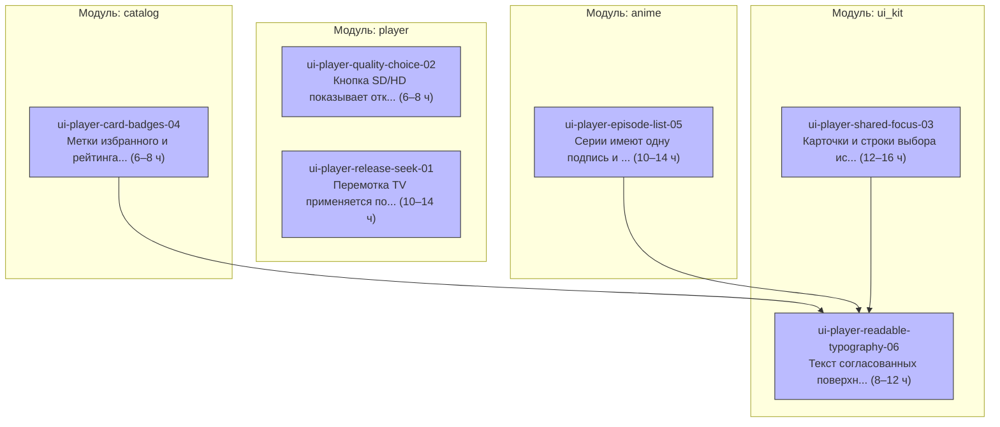

# Эпик: карточки, серии и управление плеером

- **Источник плана:** [ui-player-intents-2026-10-19 revision 1](../plans/ui-player-intents-2026-10-19.md)
- **Ожидаемый результат:** Отложенная TV-перемотка, явный выбор SD/HD, общий фокус и метки, подписи серий без дублей, три TV-колонки, одна мобильная строка и компактный читаемый текст.
- **Оценка:** 52–72 ч разработки с автоматическими проверками; ручные проверки QA на устройствах учитываются отдельно.
- **Покрытие:** CAP-01–CAP-07 полностью распределены между шестью задачами.
- **Проверка декомпозиции:** граф зависимостей — PASS; ревью — APPROVE после одного прохода языковых исправлений и контрольной перепроверки.

## Критерии готовности эпика

- [ ] Выполнены критерии приёмки всех шести задач и CAP-01–CAP-07 утверждённого плана.
- [ ] Перемотка применяется после отпускания; SD/HD отражает открытое качество; сохраняются позиция, пауза и безопасность отменённых операций.
- [ ] Общие контуры и фокус, метки и формат рейтинга согласованы; подписи серий не дублируются; TV показывает три колонки, телефон — одну серию в ряд в обеих ориентациях.
- [ ] Калибровка текста выполнена после задач общего фокуса, меток и списка серий; сохранены читаемость, системный размер текста и области касания.
- [ ] Синхронизированы затронутые спецификации и UI Kit README; регрессии защищают изменённые контракты.
- [ ] Последовательно пройдены `fvm dart run melos run check`, `fvm dart run melos run test:e2e`, `fvm dart run melos run build:android:prod:apk`; после изменений кода/инструментов выполнен `graphify update .`.
- [ ] Обязательных отложенных частей, временных заглушек и достижимых `UnimplementedError` нет; комплексное ревью реализации завершено.
- [ ] Выполненные проверки QA и ограничения физической проверки TV/телефона отражены отдельно; снимки и эмулятор не выданы за проверку читаемости на устройстве.

## Граф задач



## Задачи

| ID | Назначение | Результат | Модуль | Оценка | Родительская задача | Зависит от | Заблокировано |
| --- | --- | --- | --- | --- | --- | --- | --- |
| [ui-player-release-seek-01](ui-player-intents-2026-10-19/01-ui-player-release-seek.md) | Функциональность | Перемотка TV применяется после отпускания стрелки | player | 10–14 ч | — | — | — |
| [ui-player-quality-choice-02](ui-player-intents-2026-10-19/02-ui-player-quality-choice.md) | Функциональность | Кнопка SD/HD показывает открытое качество и открывает выбор | player | 6–8 ч | — | — | — |
| [ui-player-shared-focus-03](ui-player-intents-2026-10-19/03-ui-player-shared-focus.md) | Функциональность | Карточки и строки выбора используют общий видимый фокус | ui_kit | 12–16 ч | — | — | — |
| [ui-player-card-badges-04](ui-player-intents-2026-10-19/04-ui-player-card-badges.md) | Функциональность | Метки избранного и рейтинга согласованы на TV и телефоне | catalog | 6–8 ч | — | — | — |
| [ui-player-episode-list-05](ui-player-intents-2026-10-19/05-ui-player-episode-list.md) | Функциональность | Серии имеют одну подпись и правильную компоновку по профилю | anime | 10–14 ч | — | — | — |
| [ui-player-readable-typography-06](ui-player-intents-2026-10-19/06-ui-player-readable-typography.md) | Функциональность | Текст согласованных поверхностей компактнее и сохраняет доступность | ui_kit | 8–12 ч | — | [ui-player-shared-focus-03](ui-player-intents-2026-10-19/03-ui-player-shared-focus.md), [ui-player-card-badges-04](ui-player-intents-2026-10-19/04-ui-player-card-badges.md), [ui-player-episode-list-05](ui-player-intents-2026-10-19/05-ui-player-episode-list.md) | — |

Зависимости задают обязательный порядок выполнения. Задачи без зависимостей можно брать независимо, учитывая общие файлы и последовательный запуск Flutter/Gradle/codegen по правилам проекта. Стек веток не согласован; ветки, коммиты и внешняя публикация этим документом не создаются.

## Состав публикации

```json
{
  "schema_version": 1,
  "kind": "epic",
  "id": "ui-player-intents-2026-10-19",
  "title": "Карточки, серии и управление плеером",
  "outcome": "Отложенная TV-перемотка, явный выбор SD/HD, общий фокус и метки, подписи серий без дублей, три TV-колонки, одна мобильная строка и компактный читаемый текст.",
  "tasks": [
    {
      "id": "ui-player-release-seek-01",
      "file": "docs/tasks/ui-player-intents-2026-10-19/01-ui-player-release-seek.md"
    },
    {
      "id": "ui-player-quality-choice-02",
      "file": "docs/tasks/ui-player-intents-2026-10-19/02-ui-player-quality-choice.md"
    },
    {
      "id": "ui-player-shared-focus-03",
      "file": "docs/tasks/ui-player-intents-2026-10-19/03-ui-player-shared-focus.md"
    },
    {
      "id": "ui-player-card-badges-04",
      "file": "docs/tasks/ui-player-intents-2026-10-19/04-ui-player-card-badges.md"
    },
    {
      "id": "ui-player-episode-list-05",
      "file": "docs/tasks/ui-player-intents-2026-10-19/05-ui-player-episode-list.md"
    },
    {
      "id": "ui-player-readable-typography-06",
      "file": "docs/tasks/ui-player-intents-2026-10-19/06-ui-player-readable-typography.md"
    }
  ]
}
```
