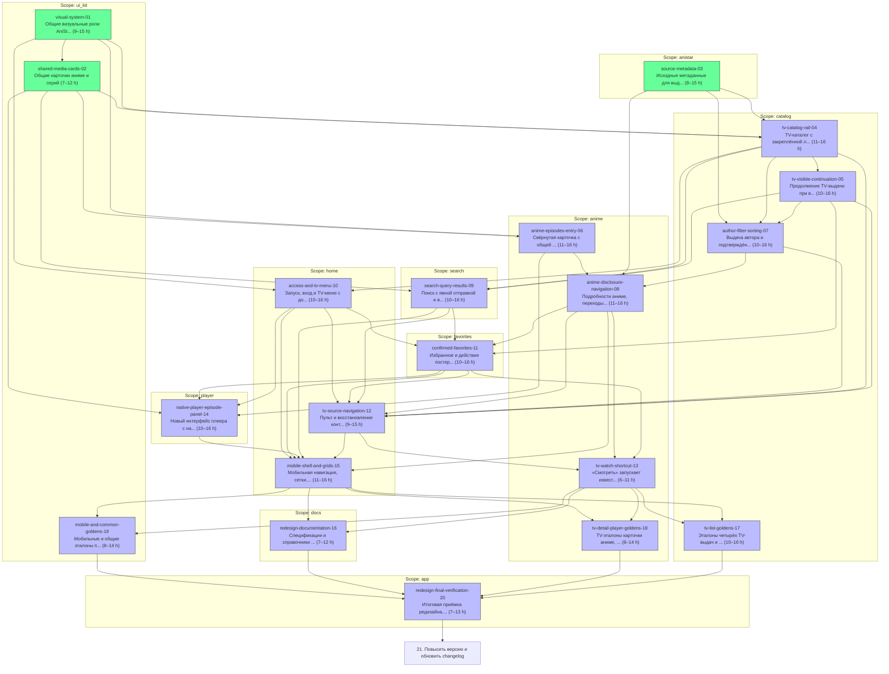

# prototype-redesign-2026-11-12

Source: prototype-redesign-2026-11-12 revision 3

- [visual-system-01](01-visual-system.md)
- [shared-media-cards-02](02-shared-media-cards.md)
- [source-metadata-03](03-source-metadata.md)
- [tv-catalog-rail-04](04-tv-catalog-rail.md)
- [tv-visible-continuation-05](05-tv-visible-continuation.md)
- [anime-episodes-entry-06](06-anime-episodes-entry.md)
- [author-filter-sorting-07](07-author-filter-sorting.md)
- [anime-disclosure-navigation-08](08-anime-disclosure-navigation.md)
- [search-query-results-09](09-search-query-results.md)
- [access-and-tv-menu-10](10-access-and-tv-menu.md)
- [confirmed-favorites-11](11-confirmed-favorites.md)
- [tv-source-navigation-12](12-tv-source-navigation.md)
- [tv-watch-shortcut-13](13-tv-watch-shortcut.md)
- [native-player-episode-panel-14](14-native-player-episode-panel.md)
- [mobile-shell-and-grids-15](15-mobile-shell-and-grids.md)
- [redesign-documentation-16](16-redesign-documentation.md)
- [tv-list-goldens-17](17-tv-list-goldens.md)
- [tv-detail-player-goldens-18](18-tv-detail-player-goldens.md)
- [mobile-and-common-goldens-19](19-mobile-and-common-goldens.md)
- [redesign-final-verification-20](20-redesign-final-verification.md)
- [redesign-version-changelog-21](../redesign-release-preparation/21-redesign-version-changelog.md) — отдельная задача после итоговой приёмки редизайна.



```json
{
  "kind": "epic",
  "id": "prototype-redesign-2026-11-12",
  "title": "prototype-redesign-2026-11-12",
  "outcome": "Tasks from approved plan prototype-redesign-2026-11-12",
  "tasks": [
    {
      "id": "visual-system-01",
      "file": "docs/tasks/prototype-redesign-2026-11-12/01-visual-system.md"
    },
    {
      "id": "shared-media-cards-02",
      "file": "docs/tasks/prototype-redesign-2026-11-12/02-shared-media-cards.md"
    },
    {
      "id": "source-metadata-03",
      "file": "docs/tasks/prototype-redesign-2026-11-12/03-source-metadata.md"
    },
    {
      "id": "tv-catalog-rail-04",
      "file": "docs/tasks/prototype-redesign-2026-11-12/04-tv-catalog-rail.md"
    },
    {
      "id": "tv-visible-continuation-05",
      "file": "docs/tasks/prototype-redesign-2026-11-12/05-tv-visible-continuation.md"
    },
    {
      "id": "anime-episodes-entry-06",
      "file": "docs/tasks/prototype-redesign-2026-11-12/06-anime-episodes-entry.md"
    },
    {
      "id": "author-filter-sorting-07",
      "file": "docs/tasks/prototype-redesign-2026-11-12/07-author-filter-sorting.md"
    },
    {
      "id": "anime-disclosure-navigation-08",
      "file": "docs/tasks/prototype-redesign-2026-11-12/08-anime-disclosure-navigation.md"
    },
    {
      "id": "search-query-results-09",
      "file": "docs/tasks/prototype-redesign-2026-11-12/09-search-query-results.md"
    },
    {
      "id": "access-and-tv-menu-10",
      "file": "docs/tasks/prototype-redesign-2026-11-12/10-access-and-tv-menu.md"
    },
    {
      "id": "confirmed-favorites-11",
      "file": "docs/tasks/prototype-redesign-2026-11-12/11-confirmed-favorites.md"
    },
    {
      "id": "tv-source-navigation-12",
      "file": "docs/tasks/prototype-redesign-2026-11-12/12-tv-source-navigation.md"
    },
    {
      "id": "tv-watch-shortcut-13",
      "file": "docs/tasks/prototype-redesign-2026-11-12/13-tv-watch-shortcut.md"
    },
    {
      "id": "native-player-episode-panel-14",
      "file": "docs/tasks/prototype-redesign-2026-11-12/14-native-player-episode-panel.md"
    },
    {
      "id": "mobile-shell-and-grids-15",
      "file": "docs/tasks/prototype-redesign-2026-11-12/15-mobile-shell-and-grids.md"
    },
    {
      "id": "redesign-documentation-16",
      "file": "docs/tasks/prototype-redesign-2026-11-12/16-redesign-documentation.md"
    },
    {
      "id": "tv-list-goldens-17",
      "file": "docs/tasks/prototype-redesign-2026-11-12/17-tv-list-goldens.md"
    },
    {
      "id": "tv-detail-player-goldens-18",
      "file": "docs/tasks/prototype-redesign-2026-11-12/18-tv-detail-player-goldens.md"
    },
    {
      "id": "mobile-and-common-goldens-19",
      "file": "docs/tasks/prototype-redesign-2026-11-12/19-mobile-and-common-goldens.md"
    },
    {
      "id": "redesign-final-verification-20",
      "file": "docs/tasks/prototype-redesign-2026-11-12/20-redesign-final-verification.md"
    }
  ]
}
```
